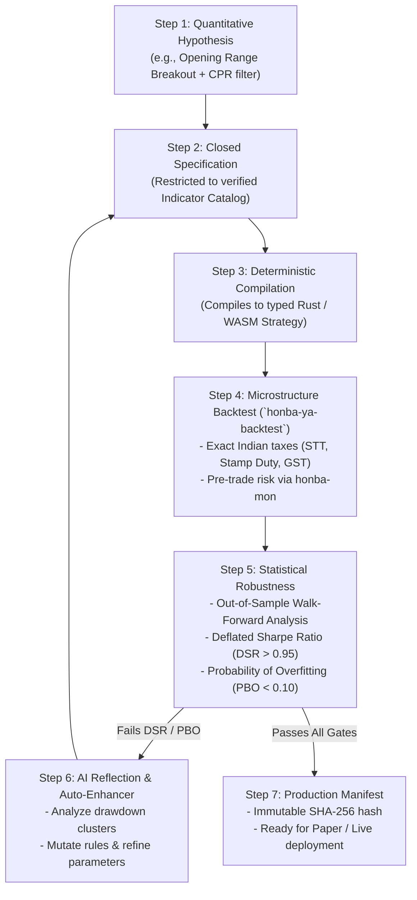

# AI Engine & Autonomous Quant Researcher (`honba-nou`)

> **[STATUS: IMPLEMENTED]** — `honba-nou`. See [Platform Conformance Matrix](conformance_matrix.md).

> **Architectural Doctrine**: AI-Native by Design, Strictly Bounded by Type Safety. Honba embeds frontier large language models (Claude, Gemini) and reinforcement learning into a closed, mathematically grounded quantitative research operating system. Dynamic code execution (`eval`) and ungrounded trading decisions are strictly forbidden.

---

## 1. Architectural Philosophy: The Governed Intelligence Model

Most algorithmic trading frameworks that incorporate AI follow an irresponsible paradigm: they prompt an LLM to generate unstructured Python code, execute it via `eval()` or unverified subprocesses, and hope it doesn't blow up an account.

Honba rejects this approach entirely. In Honba, **AI operates within a Governed Intelligence Model**:

```text
 ┌────────────────────────────────────────────────────────────────────────┐
 │                    HONBA GOVERNED AI ARCHITECTURE                      │
 ├────────────────────────────────────────────────────────────────────────┤
 │  FRONTIER AI AGENTS (Claude 3.7 Sonnet, Gemini 2.5 Pro)                │
 │  - Communicates exclusively via Model Context Protocol (MCP)           │
 │  - Restricted to verified Indicator Catalog & Domain Vocabulary        │
 ├────────────────────────────────────────────────────────────────────────┤
 │  CLOSED DECISION PARSER (`honba_core::Decision`)                       │
 │  - Strict JSON schema: serde(deny_unknown_fields)                      │
 │  - Mandatory SEBI algo_id & scrip price band grounding                 │
 │  - Synchronous pre-trade risk interception via `honba-mon`             │
 ├────────────────────────────────────────────────────────────────────────┤
 │  DETERMINISTIC PROMPT & DECISION REPLAYER                              │
 │  - Cryptographic SHA-256 prompt and completion hash chain              │
 │  - Zero API calls during deterministic historical backtesting replay   │
 ├────────────────────────────────────────────────────────────────────────┤
 │  AUTONOMOUS RESEARCH & HYPOTHESIS LOOP (`honba-nou`)                   │
 │  - In-sample hypothesis generation -> Automated compilation ->         │
 │    Out-of-sample backtest -> Deflated Sharpe Ratio (DSR) gate ->       │
 │    Immutable DatasetManifest with provenance                           │
 └────────────────────────────────────────────────────────────────────────┘
```

---

## 2. Autonomous Quantitative Research Loop

`honba-nou` ("Brain") runs an autonomous, hypothesis-driven research cycle:



---

## 3. The Verified Indicator Catalog & Closed Grammar

An AI agent cannot discover repeatable alpha if it hallucinates non-existent indicators or builds mathematically unstable formulas. Honba provides a fixed, verified **Indicator Catalog** queryable via MCP:

```json
{
  "catalog_version": "2026.1",
  "approved_indicators": [
    {
      "name": "EMA",
      "category": "Trend",
      "formula": "alpha = 2 / (period + 1); EMA_t = alpha * P_t + (1 - alpha) * EMA_{t-1}",
      "parameters": { "period": { "type": "int", "min": 2, "max": 500 } }
    },
    {
      "name": "RSI",
      "category": "Momentum",
      "formula": "Wilder smoothed RS on [0, 100]",
      "parameters": { "period": { "type": "int", "min": 2, "max": 100 } }
    },
    {
      "name": "Supertrend",
      "category": "TrendFollowing",
      "formula": "ATR trailing stop band with multiplier",
      "parameters": {
        "period": { "type": "int", "min": 5, "max": 50 },
        "multiplier": { "type": "decimal", "min": "1.0", "max": "5.0" }
      }
    },
    {
      "name": "CPR",
      "category": "IndianMicrostructure",
      "formula": "Pivot = (H + L + C) / 3; Bottom Central Pivot (BC) = (H + L) / 2; Top Central Pivot (TC) = (Pivot - BC) + Pivot",
      "parameters": {}
    },
    {
      "name": "VWAP",
      "category": "Benchmark",
      "formula": "sum(P_i * V_i) / sum(V_i) session-reset",
      "parameters": {}
    }
  ]
}
```

Any strategy specification naming an indicator outside this catalog or specifying parameters outside the bounded ranges is rejected **before** code generation or backtesting.

---

## 4. Closed Decision Grammar: `honba_core::Decision`

When an AI model generates trading signals in live or paper trading, it cannot emit free-form text or unrestricted JSON. It must emit an instance of the strictly typed `honba_core::Decision` enum:

```rust
#[derive(Debug, Clone, PartialEq, Eq, Serialize, Deserialize)]
#[serde(deny_unknown_fields)]
pub enum Decision {
    /// Submit a new limit or market order
    PlaceOrder {
        symbol: InstrumentId,
        side: OrderSide,
        order_type: OrderType,
        qty: Quantity,
        price: Option<Price>,
        algo_id: String, // Mandatory SEBI registered algorithm identifier
    },
    /// Modify an existing active order price or quantity
    ModifyOrder {
        cl_ord_id: Uuid,
        new_price: Price,
        new_qty: Quantity,
    },
    /// Cancel a specific active order
    CancelOrder {
        cl_ord_id: Uuid,
    },
    /// Emergency circuit breaker: cancel all orders for symbol or portfolio
    CancelAll {
        symbol: Option<InstrumentId>,
    },
    /// Explicit, audible decision to take no market action
    Hold {
        reason: String,
    },
}
```

### Safety Guardrails
1. **`#[serde(deny_unknown_fields)]`**: Prevents hallucinations; any unexpected JSON keys cause an immediate parse error.
2. **Mandatory SEBI `algo_id`**: Under Indian exchange regulations (Circular SEBI/HO/MRD/DP/CIR/P/2018/62), every automated order must carry an approved `algo_id`. Missing or invalid IDs trigger instant rejection.
3. **Price Band Interception**: Orders with prices outside the operational exchange circuit band (e.g., 2%, 5%, 10%) are rejected before hitting the network.
4. **Synchronous Interception by `honba-mon`**: AI decisions **never** communicate directly with broker execution adapters (`honba-te`). They must pass synchronously through the pre-trade risk engine.

---

## 5. Deterministic Prompt & Decision Replayer

How can quantitative firms audit an AI trading decision executed 18 months ago? How can an AI strategy be backtested over 5 years of historical data without spending \$50,000 on API tokens?

`honba-nou` introduces the **Deterministic Replay Harness**:

```text
 ┌──────────────────────────────────────────────────────────────┐
 │               TAMPER-EVIDENT LLM AUDIT LOG                   │
 ├──────────────────────────────────────────────────────────────┤
 │  timestamp_utc: 2026-10-21T03:45:00Z                         │
 │  model: "claude-3-7-sonnet-20250219"                         │
 │  temperature: 0.0                                            │
 │  seed: 42                                                    │
 │  prompt_sha256: 4f53cda18c2baa0c0354bb5f9a3ecbe5ed...        │
 │  prompt_context: {                                           │
 │    "symbol": "NSE:RELIANCE",                                 │
 │    "ltp": 2540.50,                                           │
 │    "rsi_14": 28.4,                                           │
 │    "cpr_state": "VirginCPR_Support_Tested",                  │
 │    "current_position": "Flat"                                │
 │  }                                                           │
 │  raw_response: "{\"PlaceOrder\":{\"symbol\":\"NSE:RELIANCE\",│
 │                 \"side\":\"Buy\",\"order_type\":\"Limit\",   │
 │                 \"qty\":\"50\",\"price\":\"2540.00\",        │
 │                 \"algo_id\":\"SEBI_ALGO_0491\"}}"            │
 │  parsed_decision: Decision::PlaceOrder { ... }               │
 └──────────────────────────────────────────────────────────────┘
```

* **Offline Replay**: In backtesting, if a prompt matching `prompt_sha256` exists in the local replayer cache, the response is replayed instantaneously with zero network overhead.
* **SEBI Algorithmic Audit Compliance**: If an exchange audit requests the justification for an order, the platform exports the exact market context, prompt, seed, and model response.

---

## 6. Native Model Context Protocol (MCP) Server

Honba embeds a production Model Context Protocol (MCP) server, allowing frontier AI agents in Claude Desktop, Cursor, or autonomous scripts to interact with the quant platform directly:

| Tool Name | Parameters | Description |
| :--- | :--- | :--- |
| `get_indicator_catalog` | — | Returns the complete vocabulary of verified indicators and valid parameter ranges. |
| `check_spec` | `spec: Object` | Validates strategy syntax and parameter bounds against schema without executing backtest. |
| `run_backtest` | `spec_id: String`, `symbol: String`, `from: Date`, `to: Date` | Runs microsecond event-driven backtest with full Indian taxes and slippage modeling. |
| `evaluate_metrics` | `run_id: String` | Computes un-cherrypicked performance statistics: Sharpe, Sortino, Max Drawdown, DSR, PBO, OTR. |
| `optimize_strategy` | `spec_id: String`, `method: "ga" | "bayesian"`, `iterations: Int` | Runs automated genetic or Bayesian parameter optimization loop. |
| `explain_decision` | `decision_id: String` | Retrieves cryptographic prompt audit trail and market context for an AI trading decision. |
