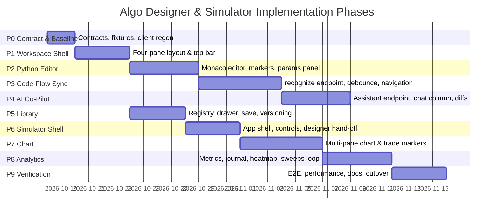

# Honba Algo Designer & Simulator — Phase-Wise Implementation Plan

> **[STATUS: IN-PROGRESS]** — `honba-fe (Algo Designer)`. See [Platform Conformance Matrix](conformance_matrix.md).

**Document ID:** HBD-2026-DES-004
**Status:** Approved for Implementation
**Version:** 2.0 (phase-wise plan; supersedes the v1.0 architecture note of the same ID)
**Last updated:** 2026-10-17
**Target Systems:** `honba-frontend`, `honba` (Core Engine + Python control plane), `honba-strategies`, `honba-docs`
**Reference Benchmark:** QuantDinger Platform (`/#/ai-asset-analysis`, `/#/strategy-ide`, `/#/indicator-ide`, `/#/backtest-center`)

**Governing decisions**

| Decision | Scope |
| :--- | :--- |
| [ADR 0029](https://github.com/honba-labs/honba/blob/main/docs/adr/0029-strategy-graph-and-algodesigner.md) | `StrategyGraph` v1, graph↔code round-trip, `verify_graph`/`verify_and_run`, AI assistant hook, ops console, result views (E9-S1..S7) |
| ADR 0017 / 0018 / 0019 | Run lifecycle & `RunId`, risk stage, order-state FSM |
| ADR 0020 / 0021 | Journal schema v1, run event streaming (SSE) |
| ADR 0022 / 0024 | AI strategy verifier, overfitting gates (DSR/PBO/holdout/walk-forward) |
| ADR 0031 / 0032 / 0033 | Signal indicators & chart reasoning, portfolio manager, equity series |

**Companion documents**

- `honba-frontend/docs/AlgoDesigner-PLAN.md` — the canvas-facing plan (Phases 1–8; 1–6 shipped, 7–8 in progress).
- `honba-docs/docs/architecture/event_loop.md` — the deterministic runtime the Simulator drives.
- `honba-docs/docs/backtesting/*` — cost, latency and validation models the Simulator surfaces.

---

## 1. Purpose of This Document

The previous revision of this document (v1.0) described the **target architecture** of two consolidated workspaces — the **Honba Algo Designer** and the **Honba Simulator** — and listed a coarse four-phase roadmap. This revision keeps that architecture as the specification of record and **elaborates it into an executable, phase-wise implementation plan**:

- It records the **baseline** (what already ships in `honba-frontend` and `honba`) so no phase re-plans finished work.
- It corrects one architectural assumption against implementation reality (graph-first, bidirectional sync — see §4.3).
- It decomposes the remaining work into **ten phases (P0–P9)**, each with objectives, work items pinned to real files/endpoints, dependencies, deliverables, acceptance criteria and verification commands.
- It adds a **cross-repo workstream table**, a **risk register** and **quality gates** that a phase must clear before the next begins.

Nothing here is a second source of truth for strategy semantics: the graph document, the generated Python and the Rust `StrategyIr` remain the single contract (ADR 0029 D16).

---

## 2. Executive Summary

Honba is unifying and elevating algorithmic strategy creation, AI co-piloting and institutional simulation by consolidating distinct analytical workflows into two integrated workspaces:

```
+-------------------------------------------------------------------------------+
|                             QuantDinger Workflows                             |
+-------------------------------------------------------------------------------+
|  AI Research              Strategy IDE            Indicator IDE     Backtest  |
|  (/#/ai-asset-analysis)   (/#/strategy-ide)       (/#/indicator-ide)  Center  |
+-------------------------------------------------------------------------------+
                                      |
                     CONSOLIDATION & UNIFICATION
                                      v
+-------------------------------------------------------------------------------+
|                               Honba Ecosystem                                 |
+------------------------------------+------------------------------------------+
|          HONBA ALGO DESIGNER       |             HONBA SIMULATOR              |
|  * Python Code Editor (Monaco)     |  * Event-driven Backtest Engine          |
|  * Interactive Strategy Flow Graph |  * Multi-Pane Interactive Chart Preview  |
|  * AI Strategy Co-Pilot Column     |  * Indicator Visual Sandbox              |
|  * Bidirectional Graph <-> Code    |  * Institutional Performance Analytics   |
|  * Strategy & Indicator Library    |  * Trade Execution Journal & Heatmaps    |
+------------------------------------+------------------------------------------+
```

Two browser entry points, both already registered in `core/apps.ts`:

1. **Honba Algo Designer** (`algodesigner.html` → `src/apps/algodesigner-app.tsx`) — a four-pane workspace: collapsible **Library drawer**, **Python code editor**, **interactive Strategy Flow canvas**, and an **AI Co-Pilot column**, under one contextual top bar (Save, Library, Verify, Simulate →, Export/Theme).
2. **Honba Simulator** (`simulator.html` → `src/apps/simulator-app.tsx`) — a full-lifecycle simulation workbench: universe/benchmark/cost controls, multi-pane price + indicator chart with trade markers, and an institutional analytics bench (equity, drawdown, trade journal, monthly heatmap, trust badges).

**Delivery model.** Ten phases, ~45 ideal engineering days, sequenced P0 → P9 with P5 (Library) parallelisable against P2–P4 and P8 (analytics) reusable across both apps. Each phase ends in a passing, demonstrable slice; there is no "big bang" cutover except deleting the Simulator placeholder in P9.

---

## 3. Product Consolidation: QuantDinger → Honba

Strengths, limitations and Honba's evolution, as established in the v1.0 survey (retained verbatim in intent):

| Dimension | QuantDinger Implementation | Honba Evolution & Target |
| :--- | :--- | :--- |
| **Strategy development** | Standalone Monaco editor in `/#/strategy-ide`; manual tab switching to reach charts/indicators. | **Split-screen dual view**: Python editor and live Strategy Flow always visible together, with the Library one drawer-click away. |
| **Visual flow** | None — strategies exist only as raw Python. | **Derived, bidirectional flow**: the `StrategyGraphShape` renders as typed nodes/edges; code is generated from it and hand-edits are recognised back (ADR 0029 S2/S3). |
| **AI co-pilot** | Right-side prompt composer returning snippets to copy/paste. | **Direct mutation agent**: assistant column with structured graph/code diff cards, one-click **Apply**, full undo via revision snapshots, and ADR 0029 S5 *propose-never-execute* (candidates routed through the verifier before they can run). |
| **Error handling** | Errors surfaced only on "Verify Code" or run. | **Continuous validation**: debounced parse/verify, inline editor markers, and a Flow canvas that never clears on a syntax error — it holds the last valid DAG with a status badge. |
| **Indicator development** | Separate `/#/indicator-ide`; manual conversion to a CTA strategy. | **Unified registry**: indicators and strategies share one catalogue derived from the registered Python indicators; preview in the Simulator or embed in the Designer in one click. |
| **Backtesting** | Results isolated in `/#/backtest-center`. | **Direct "Simulate →" pipeline**: compiled strategy hand-off from Designer to Simulator with the run parameters preserved. |

---

## 4. Baseline Assessment (2026-10-17)

### 4.1 What already ships

**Algo Designer — canvas track (`honba-frontend/docs/AlgoDesigner-PLAN.md`).**

| Phase | Capability | Status |
| :--- | :--- | :--- |
| 1 | Store modernisation: `positions`, selection, `isModified`, revision hashing; freeform canvas (drag/zoom/pan/snap) | Done (`6d1fa5e`) |
| 2 | Categorised node palette (catalogue-introspected); `BaseHonbaNode` + 10 specialised node cards | Done |
| 3 | Port-typed connection validation; `HonbaInsertableEdge` midpoint splicing | Done |
| 4 | Node inspector drawer with dynamic parameter forms; continuous code generation | Done |
| 5 | In-canvas verify/defect locating; run diagnostics; ADR 0029 trust badges; native SVG equity/drawdown; ops console | Done (`4220b86`) |
| 6 | JSON export/replace, SHA-256 version snapshots, unit tests | Done |
| 7 | AI assistant: tri-kind messages (`discussion`/`candidate`/`validation_error`), graph diffs, `applyProposal`, blocked quarantine | In progress (`0b9303c`) — prompt handling is a **local stub** |
| 8 | Sweeps panel: parameter grid, walk-forward config, async job store with `localStorage`, results matrix, "apply optimal" | In progress |

**Backend contracts already exposed** (generated client, `src/core/api/generated/client.ts`):

- `POST /strategies/verify` → `StrategyManifest` in, `StrategyIr` out (`honba-api/src/verify.rs`).
- `POST /backtests`, `GET /backtests/{id}`, `GET /backtests/{id}/journal` → `TradesResponse`.
- `POST /sweeps`, `GET /sweeps/{id}`.
- Profile persistence: `putProfileLayoutsByName`, `putProfileModulesById`.
- Python services: `honba/strategies/graph.py`, `graph_codegen.py`, `graph_recognize.py`, `designer.py` (`verify_graph`, `verify_and_run`, `graph_source_lines`, `diff_graphs`, versions, `trust_badges`), `honba/ai/designer_assistant.py`.

**Frontend building blocks already in `package.json`:** `@xyflow/react@12.12`, `openalgo-charts@2.6.4`, `zustand@5`, `lucide-react`, plus the workbench indicator runtime (`core/indicators`, 502 indicators / 16 categories) and `core/data-layer.ts` + `core/bhavcopy-pool.ts` for bars.

### 4.2 Gap matrix

| Target capability (§5) | Current state | Gap | Phase |
| :--- | :--- | :--- | :--- |
| Four-pane workspace under one top bar | Tab-switched views (`canvas`/`code`/`verify`/…) in `algodesigner-app.tsx` | Layout, resizable splitters, persistent top-bar actions | P1 |
| Rich Python editor with diagnostics | `CodePane` is a plain `<textarea>` | Monaco/CodeMirror, Python language service, marker mapping | P2 |
| Code ↔ Flow continuous sync | Graph → code exists; **no code → graph path in the frontend** | `POST /strategies/recognize` + debounced sync + node-id stabilisation | P3 |
| AI Co-Pilot with real proposals | `proposeAI` keyword stub in `store.ts` | Wire `designer_assistant.py`; code-diff preview; chips | P4 |
| Strategy & Indicator Library | No library UI; `registry.json` unused in app | Registry/`GET /strategies` integration, drawer, save/versioning, fork | P5 |
| Simulator workspace | `simulator-app.tsx` is a 2-line `mountPlaceholder('simulator')` | Entire app: shell, controls, hand-off, run | P6 |
| Multi-pane chart + trade markers | Chart stack exists in Workbench only | Simulator chart wiring, overlay/sub-pane plumbing, journal markers | P7 |
| Analytics bench, journal, heatmap, sweeps hand-off | Native SVG equity/drawdown reusable from P5 canvas work | Metrics ribbon, trade pairing, CSV export, heatmap, sweeps recall | P8 |
| End-to-end verification & cutover | Phase 1–8 unit tests only | Cross-app E2E, performance budgets, docs, placeholder removal | P9 |

### 4.3 Architectural correction: graph-first, not read-only-AST

The v1.0 document described the Flow canvas as a **read-only reflection of Python code** (code → AST → graph). Implementation and ADR 0029 settled the opposite primacy, and this plan adopts it:

- **The `StrategyGraphShape` is authoritative.** The canvas is interactive; `generateCode()` renders it to a deterministic Python module (`graph_codegen`); `source_hash` covers both the module and the `.strategy.json` sidecar.
- **Code is a first-class projection with a return path.** Hand-edits in the editor are recognised back into the graph by `graph_recognize.recognize()` (ADR 0029 S3), which returns `{ graph, spans, code_only }`; non-subset spans are marked `code_only` and are never reconstructed lossily.
- **Therefore the canvas is *bidirectional*, not read-only.** What remains true from v1.0 is the *safety* property: the graph never tears down on invalid input — it holds the last structurally valid DAG and shows "Pending valid syntax…", and node positions are stabilised so layout does not jump.

This correction is the basis of Phase 3 and is called out here so the rest of the document can assume it.

---

## 5. Target Architecture

### 5.1 Invariants

1. **Single source of truth.** Graph (`.strategy.json` / `StrategyGraphShape`) + generated Python + Rust `StrategyIr` share one validation vocabulary; the frontend never executes strategy logic and never computes backtest results locally.
2. **Derived catalogue.** Node types and indicator parameters are introspected from the registered Python indicators (`core/graph/catalogue.ts` mirrors them), never hard-listed.
3. **Typed ports.** Connections are validated by port kind (`series`, `bool`, `size`, `order`); incompatible attempts are rejected with visual feedback.
4. **Safe mutation.** Every graph mutation is snapshot-versioned (SHA-256) and reversible; verify/run operate on the exact graph on screen (`isModified` dirty guard + hash comparison).
5. **Propose-never-execute.** AI candidates and any unverified graph are quarantined from execution until they pass the verifier (ADR 0029 S5).
6. **Reuse, don't re-implement.** Charting uses `openalgo-charts` (already a dependency); analytics equity/underwater stay native SVG (ADR 0029 S7); runs, sweeps, journals and orders go through the existing HTTP client.

### 5.2 Algo Designer workspace

```
+-------------------------------------------------------------------------------------------------------+
|  Top Bar: [Strategy: Momentum_SMA_Cross v1.2] [Save] [Library] [Verify] [Simulate ->] [Export/Theme]   |
+---------------------+-----------------------------+-----------------------------+---------------------+
|   STRATEGY LIBRARY  |      PYTHON CODE EDITOR     |     STRATEGY FLOW CANVAS    |     AI CO-PILOT     |
|   (Collapsible)     |         (Monaco)            |       (@xyflow/react)       |     (Agent Pane)    |
|                     |                             |                             |                     |
| > Built-in CTA      | 1: class SmaCrossover:      |    +-------------------+    | "How can I reduce   |
|   - sma_crossover   | 2:   fast = 10              |    |  Universe: NSE    |    |  max drawdown?"     |
|   - macd_trend      | 3:   slow = 30              |    +---------+---------+    |                     |
| > Mean Reversion    | 4:   def on_bar(self, bar): |              |              | [AI Co-Pilot]       |
| > Custom Saved      | 5:     if cross_above(...): |       +------+------+       | "Add an ATR trailing|
| > Indicators        | 6:       self.buy(qty=100)  |       v             v       |  stop (period=14)." |
|                     | [Ln 5, Col 12] [Clean AST]  |   [Fast SMA]    [Slow SMA]  |                     |
| [New Strategy +]    | [Parameters: fast 10, slow 30] |    +------+------+       | [Diff Preview]      |
|                     |                             |       [Cross Condition]     | + def add_atr_stop()|
|                     |                             |              v              | [Apply to Code]     |
|                     |                             |      [Market Order Buy]     | [Discard]           |
+---------------------+-----------------------------+-----------------------------+---------------------+
```

- **Library drawer (left, collapsible, 280px):** strategies by category (backed by `registry.json` / `GET /strategies`), user-saved strategies, indicator catalogue, "New Strategy".
- **Code editor (centre-left):** Monaco (lazy-loaded), Python highlighting, inline diagnostics mapped from verify issues, parameter declarations.
- **Flow canvas (centre-right):** the existing `canvas.tsx` + `palette.tsx` + `inspector.tsx`; palette may dock inside the drawer in narrow viewports.
- **AI Co-Pilot (right, 380px, collapsible):** conversation, suggestion chips, diff cards, apply/discard.

### 5.3 Bidirectional Code ↔ Flow pipeline

```
[Canvas edit] ---> [Graph mutation in store] --------------------+
                                                                 v
                                                       [generateCode() -> Monaco]
[Editor keystroke]                                                |
        |                                                         |
        v                                                         |
 [Debounce gate: 300ms]                                          |
        |                                                         |
        v                                                         |
 [POST /strategies/recognize]  (graph_recognize.recognize)        |
      /                   \                                       |
 (code_only / spans)   (recognised graph)                        |
      |                     |                                     |
 [Keep last valid graph]  [Diff vs current graph]                 |
 [Inline squiggle]        [Stabilise node positions]              |
 [Badge: "Pending..."]    [Update Flow]  <-----------------------+
                          [Badge: "Graph synced (clean)"]
```

1. **Debounce gate.** Editor keystrokes trigger a 300 ms debounce.
2. **Recognition.** `POST /strategies/recognize` runs `graph_recognize` server-side and returns the recovered graph plus unrecognised line spans (`code_only`). *Implementation note (P3, FE):* the endpoint does not exist yet, so the FE ships a **client-side fast recogniser** (`core/designer/code-to-graph.ts`) that parses the generated builder subset — the "client-side fast AST parser" from the v1.0 note — behind a `Recognizer` seam. It is a pure function of `source`, so the remote recogniser can replace it without touching the sync pipeline, and it keeps `recognize(generate(g)).graph == g` honest for the generated subset (property-tested over the catalogue).
3. **Graceful error immunity.** On a syntax error or an unrecognised span, Monaco marks the offending line and the canvas retains the last valid DAG with a status badge — it never flickers or clears.
4. **Stabilisation.** Node IDs and existing `positions` are preserved across updates so nodes do not jump (already in `store.ts`).
5. **Editor ↔ canvas navigation.** `graph_source_lines()` maps node IDs to generated-source lines for click-to-focus in both directions.

### 5.4 AI Co-Pilot column

- Persistent right column; message kinds mirror `designer_assistant.py`: `discussion` | `candidate` | `validation_error`.
- Prompt accelerators: *Add ATR trailing stop*, *Add RSI overbought/oversold filter*, *Optimise MA periods for 15m trend*, *Enforce 2% max daily drawdown guard*, *Convert to dual-direction long/short*.
- Conversational context: active graph + generated code + current parameters + last run metrics + instrument metadata.
- Candidates render **interactive diff cards** (graph diff badges already implemented; add unified code diff), with **Apply** (snapshot → `setGraph` → regenerate code → recalc flow) and **Discard**.
- Blocked candidates carry an explicit `BLOCKED` pill and cannot run (ADR 0029 S5).

### 5.5 Strategy & Indicator Library

- **Source:** `honba-strategies/registry.json` (category + indicator-family tags) surfaced by `GET /strategies`, plus user-saved manifests from the profile API and `localStorage`.
- **Saved manifest** (compatible with `honba-strategies`):

```typescript
export interface SavedStrategyManifest {
  id: string;                      // slug, e.g. 'sma_crossover'
  name: string;
  version: string;                 // semver, e.g. '1.2.0'
  category: 'momentum/trend' | 'momentum/breakout' | 'mean_reversion' | 'volatility' | 'options' | 'custom';
  description: string;
  tags: string[];
  author: string;
  updated_at: number;
  python_source: string;
  graph: StrategyGraphShape;
  default_universe: { symbol: string; exchange: string; timeframe: string };
  default_params: Record<string, unknown>;
  backtest_benchmark?: { sharpe_ratio: number; max_drawdown_pct: number; win_rate: number };
}
```

- **Save & revision:** `Ctrl+S`/Save hashes code + graph, persists to `localStorage` and the profile API (`putProfileLayoutsByName` / `putProfileModulesById`), and appends a `DesignerVersion` snapshot.
- **Export / fork:** Python `.py`, JSON manifest, and one-click duplicate.

### 5.6 Simulator workspace

```
+-------------------------------------------------------------------------------------------------------+
|  Top Bar: [Strategy: Momentum_SMA_Cross] [Symbol: NSE:TCS] [Timeframe: 5m] [Period: 6M] [Run Simulation]
+-----------------------------+-------------------------------------------------------------------------+
|     SIMULATION CONTROLS     |                   INTERACTIVE MULTI-PANE CHART                         |
| Symbol: TCS (NSE)           |  Main: candles + Fast/Slow SMA, buy/sell markers                       |
| Benchmark: NIFTY 50         |  Sub-pane 1: RSI 14 (70/30 bands)                                      |
| [1M][3M][6M][1Y][Custom]    |  Sub-pane 2: Volume + VWAP                                             |
| Capital: 100,000 INR        +-------------------------------------------------------------------------+
| Commission / Slippage       |  [Total Return] [CAGR] [Sharpe] [Max DD] [Win Rate] [Profit Factor]   |
| Fill Model: bar_fill        +-------------------------------------------------------------------------+
| [Run Backtest]              |  [Equity / DD] [Trade Journal] [Monthly Returns] [Logs & Events]       |
| [Parameter Sweeps]          |  Equity growth vs benchmark (NIFTY 50)                                  |
+-----------------------------+-------------------------------------------------------------------------+
```

- **Chart engine:** `openalgo-charts` (already used by the Workbench), synchronised panes; **equity/underwater analytics stay native SVG** per ADR 0029 S7.
- **Trade markers:** derived by pairing fills from `GET /backtests/{id}/journal` into round trips; tooltip shows execution price, slippage, size, realised PnL, exit reason.
- **Analytics:** metrics ribbon, equity + underwater, filterable trade journal with CSV export, monthly returns heatmap, and ADR 0029 trust badges (DSR/PBO/holdout/walk-forward) from `ValidationBlock`.

### 5.8 Signals vs. Alerts: QuantDinger Concept Mapping & Honba Architecture

A recurring comparison between QuantDinger and Honba is the relationship between **"Signals"** and **"Alerts"**:

| Dimension | QuantDinger Concept | Honba Native Architecture |
| :--- | :--- | :--- |
| **Origin & Definition** | **Signal**: Boolean / discrete event generated when strategy or indicator conditions evaluate to true (e.g., `crosses_above`, `rsi < 30`). | **Strategy Signal**: Emitted by `condition` / `logic` graph nodes via the `signal` boolean port (`PortKind: 'bool'`). Evaluated on bar closes. |
| **Execution Path** | Directly routes to Order Execution (Trade) or triggers an external notification. | 1. **Order Path**: Wire `signal` port -> `order` node (`Buy` / `Sell`) for automatic position execution.<br>2. **Alert Path**: Publishes to `src/core/alerts/bus.ts` (`AlertSourceFamily: 'strategy'`). |
| **Delivery & Sinks** | Webhooks, desktop notifications, email alerts. | **Alert System** (`src/core/alerts/types.ts`): Sinks via `DeliveryKind`: `toast`, `log`, `notification`, `sound`, `webhook`, `action` with configurable `cooldownMs` and repeat rules (`once` vs `everyTime`). |
| **Simulation & History** | "Signal Center" / Historical Signal Log. | **Simulator Run Journal**: Signals are recorded alongside order fills in the event journal, rendered as interactive markers on the chart and tabulated in the Trade & Signal Journal. |

In AlgoDesigner, every `ConditionNode` produces a `signal` port. Strategies can treat this as an automated trade trigger, an alert notification, or both.

### 5.9 Module layout (current → target)

```
honba-frontend/src/
├── apps/
│   ├── algodesigner-app.tsx                 # shell mount; delegates to workspace/
│   ├── algodesigner/
│   │   ├── workspace-layout.tsx             # NEW  four-pane layout + splitters
│   │   ├── split-pane.tsx                   # NEW  resizable pane primitive
│   │   ├── code-editor-pane.tsx             # NEW  Monaco wrapper (replaces CodePane)
│   │   ├── library-drawer.tsx               # NEW  strategy + indicator browser
│   │   ├── params-panel.tsx                 # NEW  GUI parameter tuner (pythonParams)
│   │   ├── canvas.tsx / palette.tsx / inspector.tsx / nodes/ / edges/   # existing (P1–P4)
│   │   ├── panels.tsx                       # existing verify/run/ops/assistant views
│   │   └── sweeps-panel.tsx                 # existing (P8)
│   ├── simulator-app.tsx                    # REPLACES placeholder
│   └── simulator/
│       ├── components/
│       │   ├── simulation-controls.tsx
│       │   ├── interactive-chart.tsx
│       │   ├── metrics-ribbon.tsx
│       │   ├── equity-curve-card.tsx        # reuses EquityDrawdownChart (SVG)
│       │   ├── trade-journal-table.tsx
│       │   └── monthly-heatmap.tsx
│       └── store/simulator-store.ts
├── core/
│   ├── designer/
│   │   ├── store.ts                         # existing (extend: panes, library, sync)
│   │   ├── assistant-types.ts               # existing
│   │   ├── code-to-graph.ts                 # NEW  debounced recognize() client
│   │   ├── library-store.ts                 # NEW  catalogue + saved manifests
│   │   └── jobs-store.ts / jobs.ts / ops*.ts# existing (P8/P5)
│   └── graph/ (model.ts, codegen.ts, catalogue.ts, validation.ts)   # existing
```

---

## 6. Phase-Wise Implementation Plan

Every phase lists: **Goal**, **Work items** (checkboxed, with file paths and repos), **Dependencies**, **Deliverables**, **Acceptance criteria**, **Verification**.

Repos are abbreviated: **FE** = `honba-frontend`, **HB** = `honba`, **STRAT** = `honba-strategies`, **DOCS** = `honba-docs`.

---

### Phase 0 — Contract, Baseline & Fixture Alignment

**Goal.** Remove unknowns so later phases only write UI. Confirm which backend endpoints exist, add the two missing ones as tracked cross-repo tickets, and freeze regression fixtures.

**Work items**

- [ ] Record the baseline: run `npm run typecheck && npm run test` (FE) and `cargo test` + `pytest` (HB); capture coverage of `core/designer/*` and `core/graph/*`.
- [ ] Freeze fixtures: `defaultGraph()` → `fixtures/graph-sma-cross.json`; a recognised round-trip pair `README-backtest` → graph, for P3 regression.
- [ ] **FE:** regenerate the client (`npm run codegen` → `make -C ../honba schema client`) and diff against `core/types/generated/domain.ts` (known stale: `cancel_requested`, risk/order codes, response `error`).
- [ ] **HB:** confirm the `POST /strategies/recognize` and assistant-invoke contracts (see §8) — endpoints, request/response shapes and error codes.
- [ ] **HB:** confirm the run request surface needed by the Simulator: `BacktestRequest` carries `strategy`, `universe`, `start`, `end`, `bar_spec`, `fill_model`, `initial_capital`, `seed`; `ExecutionConfig` carries `fill_model`, `slippage_multiplier`, `cost_model_version`. Document any missing control (e.g. explicit commission) as a contract gap.
- [ ] **STRAT:** confirm `registry.json` is sufficient to drive the Library (category, tags, description, path) and note any fields the UI needs added.
- [x] **DOCS:** this document is listed in `mkdocs.yml` under Architecture as *Algo Designer & Simulator (plan)*.

**Dependencies.** None.

**Deliverables.** Signed gap matrix (§4.2); regenerated client; two tracked HB endpoint tickets; fixture set.

**Acceptance criteria.** Baseline test commands recorded green; `npm run codegen` diff contains no unexplained drift; endpoint contracts agreed in writing.

**Verification.** `npm run typecheck`, `npm run test`, `cd honba && cargo test`, `pytest`.

---

### Phase 1 — Algo Designer Four-Pane Workspace Shell

**Goal.** Replace the tab-switched app with the persistent four-pane workspace under one contextual top bar, preserving every existing panel as a pane.

**Work items**

- [ ] **FE:** add `apps/algodesigner/split-pane.tsx` — a resizable, keyboard-accessible pane primitive (CSS grid + pointer drag, min/max widths, persisted sizes).
- [ ] **FE:** add `apps/algodesigner/workspace-layout.tsx` — slots for `library | code | canvas | assistant`; collapse/expand for library and assistant; a **focus mode** that expands one pane (the existing tabs become a focus selector, so no capability is lost).
- [ ] **FE:** rewrite `apps/algodesigner-app.tsx` to mount `WorkspaceLayout`; move Verify/Run/Sweeps/Ops/Results panels into a bottom/overlay **drawer** invoked from the top bar.
- [ ] **FE:** extend `core/designer/store.ts`: `layout` slice (`libraryOpen`, `assistantOpen`, pane sizes, `focus`), persisted to `localStorage`.
- [ ] **FE:** re-home `palette.tsx` — dockable to the left rail or embedded in the Library drawer depending on viewport width.
- [ ] **FE:** top bar: `[Strategy name + dirty dot] [Save] [Library] [Verify] [Simulate →] [Export/Theme]`; wire `Ctrl+S`, `Delete`/`Backspace`, `Esc`.
- [ ] **FE:** responsive fallback below 1280 px — canvas + one side pane, others collapsible.

**Dependencies.** P0.

**Deliverables.** `workspace-layout.tsx`, `split-pane.tsx`, reduced `algodesigner-app.tsx`, updated store slice.

**Acceptance criteria.** All eight current tabs are reachable without regression; pane sizes persist across reloads; keyboard shortcuts operate only when focus is not inside the editor; `simulator.html?symbol=…` deep-link entry is unchanged.

**Verification.** `npm run typecheck && npm run test`; manual matrix: every former tab reachable in the new layout; vitest cases for the layout slice (collapse, focus, persistence).

---

### Phase 2 — Python Code Editor (Monaco) & Parameter Panel

**Goal.** Promote the `<textarea>` to a real Python editor with syntax highlighting, inline diagnostics and an introspected parameter panel.

**Decision to record.** Monaco (`@monaco-editor/react`) vs CodeMirror 6. Recommendation: **Monaco**, lazy-loaded via dynamic `import()` and a dedicated Vite chunk (~1 MB gz) because Python diagnostics/autocomplete are first-class; CodeMirror 6 is the fallback if bundle budget becomes binding. Either way the editor is isolated behind `code-editor-pane.tsx`.

**Work items**

- [ ] **FE:** add `apps/algodesigner/code-editor-pane.tsx` — lazy Monaco wrapper; Python language, Honba SDK autocomplete (`self.buy`, `self.sell`, `bar.close`, `bar.volume`, `self.indicators.*`), `editor.defineTheme` against Honba theme tokens.
- [ ] **FE:** map verify issues (`VerifyState.issues[].lineno`) to Monaco markers; clear markers on edit.
- [ ] **FE:** add `apps/algodesigner/params-panel.tsx` — introspects `pythonParams(graph)` (`core/graph/codegen.ts`) into typed controls (number/select/bool) that write back through the existing inspector/params store actions.
- [ ] **FE:** editor header status strip: `[Ln x, Col y] [AST: clean | pending] [hash: abc1234]`.
- [ ] **FE:** ensure undo/redo (`Ctrl+Z`/`Ctrl+Y`) is the editor's own stack and does not fight the store's version snapshots.
- [ ] **FE:** update `algodesigner.html`/`vite.config.*` chunking so Monaco does not inflate the initial Designer bundle.

**Dependencies.** P1.

**Deliverables.** `code-editor-pane.tsx`, `params-panel.tsx`, marker mapping, chunk config.

**Acceptance criteria.** Editing parameters updates generated code and vice-versa; verify issues appear as gutter + squiggle markers on the right lines; initial route load does not include Monaco in the main chunk; `params-panel` round-trips without mutating the graph hash unless a value changed.

**Verification.** `npm run typecheck && npm run test`; a vitest test asserting marker line mapping from a synthetic `VerifyState`; bundle-size check on the Designer entry.

---

### Phase 3 — Bidirectional Code ↔ Flow Synchronisation

**Goal.** Close the loop: hand-edited Python is recognised back into the graph, debounced, error-tolerant, and never loses node positions.

**Work items**

- [ ] **HB:** add REST `POST /strategies/recognize` wrapping `graph_recognize.recognize()`; response `{ graph | null, spans: [{start_line, end_line, reason}], code_only: boolean }`; 422 with `reason=code_only` is **not** an error — it is a normal result. *(Pending: `honba serve` is Rust-only and has no graph awareness, so this needs a Python-side or Rust-side recogniser; see §12.)*
- [ ] **HB:** expose `graph_source_lines()` for node↔line mapping in the same response (or a sibling endpoint) so both navigation directions use one call. *(Pending; the FE maps ids→lines locally via `diagnostics.nodeLine` meanwhile.)*
- [x] **FE:** add `core/designer/code-to-graph.ts` — 300 ms debounced call, `AbortController` cancellation, in-flight coalescing. *(Implemented as a client-side recogniser of the generated subset behind a `Recognizer` seam; a remote recogniser drops in unchanged.)*
- [x] **FE:** store slice: `sync` = `{ status: 'idle'|'pending'|'synced'|'invalid', lastGraph, spans }`; canvas keeps rendering `lastGraph` while `status==='invalid'`. *(Slice name is `sync`; the retained graph is the store's `graph` itself, so nothing flickers.)*
- [x] **FE:** apply returned graph via the existing `setGraph` path, preserving `positions` for IDs present in both graphs (already supported) and auto-placing new nodes via the existing layout helper.
- [x] **FE:** click a canvas node → editor scrolls/highlights its lines; click inside a generated `class` block → canvas selects the corresponding node. *(Reverse direction resolves exact `.node(...)` declaration lines only.)*
- [x] **FE:** canvas header badge: `Graph synced (clean)` / `Pending valid syntax…` / `code_only spans present`.
- [x] **FE:** conflict policy: while the editor has focus and is dirty, editor wins; canvas edits during a pending recognition cancel the recognition. *(Enforced by a source-identity guard in `applyRecognition`; canvas edits regenerate code and reset the sync slice to a clean state.)*

**Dependencies.** P2, P0 (recognize contract).

**Deliverables.** Recognise endpoint (HB), `code-to-graph.ts`, sync slice, bidirectional navigation.

**Acceptance criteria.** Typing valid Python refreshes the Flow within 350 ms without losing positions; introducing a syntax error leaves the last valid graph rendered and marks only the offending lines; round-trip identity holds for a fixture set spanning ≥10 catalogue indicators; `code_only` edits are flagged, never silently overwritten.

**Verification.** FE: vitest for the debounce/cancel logic and position stability. HB: `pytest` round-trip property `recognize(generate(g)).graph == g` over the catalogue (extend ADR 0029 S3 tests). End-to-end: scripted keystroke → flow update < 350 ms.

---

### Phase 4 — AI Co-Pilot Column

**Goal.** Replace the local keyword stub with the real assistant, presented as a persistent column with actionable graph/code diff cards and enforced propose-never-execute.

**Work items**

- [ ] **HB:** expose the assistant over HTTP (or the existing gateway) — `POST /assistant/propose` wrapping `honba/ai/designer_assistant.py`; request carries graph, generated source, last run summary and the prompt; response is a typed `discussion | candidate | validation_error` payload with findings, decisions and a candidate graph. Route every candidate through the verifier before returning (ADR 0029 S5). *(Pending: no Rust/HTTP surface for the Python assistant yet; see §12.)*
- [x] **FE:** `apps/algodesigner/ai-chat-column.tsx` — conversation list, prompt composer, chip accelerators (§5.4), streaming/typing indicator.
- [x] **FE:** replace `proposeAI` in `core/designer/store.ts` with a `client`-backed call; keep the stub behind a feature flag for offline/no-backend runs. *(Feature-detects `client.postAssistantPropose`; falls back to the local keyword engine when absent.)*
- [x] **FE:** **diff cards** — graph diff chips (`added_nodes`/`modified_nodes`/`removed_nodes`, already computed) plus a **unified code diff** rendered from `generateCode(candidate)` vs `generateCode(current)`. *(LCS diff in `core/designer/code-diff.ts`; the card compares the candidate's stored source against the live code.)*
- [x] **FE:** `Apply to Code` / `Apply to Canvas` (same action — graph is authoritative) via `snapshotVersion()` → `setGraph()`; `Discard`; both record an assistant message for audit.
- [x] **FE:** blocked cards render `BLOCKED` with findings and cannot invoke Run/Simulate. *(`canApply()` plus a disabled Apply button; `toAssistantMessage` quarantines any candidate carrying findings.)*
- [x] **FE:** token/context budget: send graph (not full conversation), last N messages, and a truncated run summary. *(`assistantContext()` trims to the last 6 turns; run summary is derived, never recomputed.)*

**Dependencies.** P3 (diffing on stable graph), P0 (assistant contract).

**Deliverables.** Assistant HTTP endpoint (HB), `ai-chat-column.tsx`, real `proposeAI`, diff cards.

**Acceptance criteria.** "Add ATR trailing stop" produces a candidate card with added risk node(s) and an applyable code diff; applying updates canvas + code atomically and is undoable; a malformed proposal surfaces as `validation_error` and is quarantined; no candidate can reach Run without a clean verify.

**Verification.** HB: `pytest` for the assistant typing + verifier routing. FE: vitest for card state transitions (discussion → candidate → applied/blocked); manual walkthrough of the five chips.

---

### Phase 5 — Strategy & Indicator Library, Save & Versioning

**Goal.** Central governance and instant reuse: browse the catalogue, save/fork custom strategies, and reopen code + graph intact. **Parallelisable with P2–P4.**

**Work items**

- [ ] **STRAT:** extend `registry.json` with any fields the Library needs (indicator families, default universe/params); keep category paths prefix-free per the repo convention. *(Pending — and moot until HB surfaces the registry; see the finding below.)*
- [x] **HB:** confirm `GET /strategies` returns enough per strategy (name, category, description, tags, path) — extend `CompiledStrategy` if not. **Finding (P5):** it does **not** and should not — `GET /strategies` returns the *session* catalogue of compiled strategies (`CompiledStrategy { id, ir }`), with no name/category/description/tags/path. The `honba-strategies/registry.json` is a separate source that HB does not currently expose. The FE therefore bundles a small template catalogue (`core/designer/strategy-templates.ts`) and treats registry fetch as a tracked HB gap.
- [x] **FE:** `core/designer/library-store.ts` — fetch catalogue + user manifests, search/filter state, merge sources (registry, profile API, `localStorage`). *(`mergeLibrary`/`filterLibrary`/`presentCategories` + manifest model; localStorage is the primary store, the profile API is the best-effort cross-device write, and the strategy catalogue is bundled pending the registry route.)*
- [x] **FE:** `apps/algodesigner/library-drawer.tsx` — search, category filter (All/CTA/Multi-Factor), per-strategy `[Open] [Simulate]`, Custom section, indicator catalogue grouped by family. *(Category filter is driven by the categories actually present — the §5.5 manifest categories — rather than the illustrative All/CTA/Multi-Factor labels.)*
- [x] **FE:** **Open** loads a strategy: set graph, regenerate code, reset editor/sync state. *(`store.openStrategy` → `setGraph`, which regenerates code and resets the sync slice.)*
- [x] **FE:** **Save flow** — `Ctrl+S`/Save builds a `SavedStrategyManifest`, writes `localStorage` + `putProfileLayoutsByName`/`putProfileModulesById`, appends a `DesignerVersion`; surface save state (saved/saving/error/offline). *(`store.saveStrategy`; uses `putProfileLayoutsByName` as the generic doc store since there is no dedicated manifest route; labels `Saved (offline)` when only localStorage succeeded.)*
- [x] **FE:** **Export** Python `.py`, JSON manifest; **Fork/Duplicate** creates a variant without touching the master. *(JSON export already shipped in the canvas pane; `.py` export added to the top bar; `store.forkStrategy` clones under a fresh id.)*
- [x] **FE:** revision history UI — list `DesignerVersion` snapshots with hash + timestamp and one-click restore (backend already exists; expose in the drawer or a modal). *(Already implemented as the canvas Versions modal; `saveStrategy` appends to the same snapshot list.)*

**Dependencies.** P1 (drawer slot); P0 (registry/endpoint contracts).

**Deliverables.** `library-store.ts`, `library-drawer.tsx`, save/export/fork, revision restore.

**Acceptance criteria.** Saving a custom strategy persists it and survives a browser reload; reopening restores code **and** flow; forking a built-in leaves the template unchanged; export round-trips through Replace-from-JSON.

**Verification.** FE: vitest for the library store merge/search and for save → reload → reopen. Manual: profile API write/read against a running `honba serve`.

---

### Phase 6 — Simulator Shell, Controls & Designer Hand-off

**Goal.** Replace the placeholder with a real workspace: asset/cost controls, a one-click hand-off from the Designer, and a working run.

**Work items**

- [x] **FE:** rewrite `apps/simulator-app.tsx` on `AppShell currentAppId="simulator"` (drop `mountPlaceholder`). *(Shipped: hydrates from the hand-off / Library / last selection and hosts the controls + results panes.)*
- [x] **FE:** `apps/simulator/store/simulator-store.ts` — active strategy (graph + name), universe, dates, timeframes, capital, fill model, slippage, run state, results, error. *(`createSimulatorStore` factory; the pure logic lives in `core/simulator/{controls,run,select,persistence}.ts`.)*
- [x] **FE:** `components/simulation-controls.tsx` — symbol (shared symbol search used by Workbench), benchmark (default NIFTY 50), period presets `[1M][3M][6M][1Y][Custom]`, capital, commission/slippage, fill model, `[Run Backtest]`, `[Parameter Sweeps]`. *(Reuses `SymbolSearchModal`; the `[Parameter Sweeps]` engine hand-off is P8. Commission/slippage are captured but flagged as not sent — see the HB bullet.)*
- [x] **FE:** **hand-off contract** — `Simulate →` in the Designer navigates to `/simulator.html?strategy=<slug>&source=designer` and passes the graph via `sessionStorage` (graphs exceed URL length); on load the Simulator validates and selects it, falling back to the Library. *(Producer shipped in P1 `handoff.ts`; `resolveSelection` validates, then falls back Library → template.)*
- [x] **FE:** `Run Backtest` → `client.postBacktests({ strategy, universe, start, end, bar_spec, fill_model, initial_capital, seed })`; poll `GET /backtests/{id}` until terminal; surface `error`/`status` per the regenerated contract. *(The wire contract is `POST /backtests` + `GET /backtests/{id}`, not `/strategies/{id}/backtests` + `/tasks/{id}`; the loop folds `pending|running` → running and keeps `completed|failed|cancelled`.)*
- [ ] **HB:** close any contract gap found in P0 (e.g. explicit commission) with a versioned request field rather than a client-side fabrication. **Finding (P6):** `BacktestRequest` is `deny_unknown_fields` and carries no commission/slippage (they live in `ExecutionConfig`, which the run request cannot reach); the panel records them as `notModelled` and never fabricates them. A versioned request field remains the open HB work.
- [x] **FE:** empty/loading/error states and a "no results yet" bench skeleton. *(Results panel: idle bench, running progress log, failed alert, metrics grid, payload preview.)*

**Dependencies.** P5 (Library fallback + strategy source), P0 (run contract).

**Deliverables.** `simulator-app.tsx`, simulator store, control panel, hand-off, working run.

**Acceptance criteria.** `Simulate →` opens the Simulator with the Designer strategy loaded and its universe/timeframe pre-filled; a run against NSE history reaches `completed` and populates the store; reload preserves the last run selection.

**Verification.** FE: vitest for the hand-off decode + run-state reducer (mocked client). Manual: Designer → Simulator → Backtest against a running `honba serve`.

---

### Phase 7 — Interactive Multi-Pane Chart & Trade Markers

**Goal.** Visualise bars, indicators and every executed trade with correct timestamp alignment.

**Work items**

- [x] **FE:** `components/interactive-chart.tsx` — `openalgo-charts` wrapper; main pane candles, overlay studies and sub-panes, a volume pane and VWAP; one shared time axis so panes stay synchronised. *(Corrected: the fixed indicator menu is superseded by a graph-driven set — the chart shows the studies the strategy actually uses, with its parameters, so the two agree (R7). PSAR/`rma` have no registry descriptor and are reported, not drawn.)*
- [x] **FE:** bar loading for the selected symbol/timeframe/period; resample to the run's `bar_spec`. *(Corrected: the Workbench data layer's display-string `time` cannot align with journal `ts_event`, so bars come from `GET /bars/{id}` (`tf=bar_spec`, run window) with a deterministic NSE-session preview fallback, labelled `source: 'preview'`.)*
- [x] **FE:** indicator series using the same parameters as the strategy's graph nodes, so the chart and strategy agree. *(Via the `openalgo-charts/indicators` registry that `chart.addIndicator` reads, not the Workbench's separate 502-catalogue.)*
- [x] **FE:** **trade markers** — fetch `GET /backtests/{id}/journal` (`TradesResponse`), pair fills into round trips (`core/simulator/trade-pairing.ts`), plot entry/exit triangles at `ts_event` (snapped to the bar); tooltip shows price, size, realised PnL and exit reason. *(Corrected: the journal carries no signal price, so slippage vs signal cannot be shown — never fabricated (R5).)*
- [x] **FE:** pending markers. *(Corrected: there is no run event stream and the journal holds only fills, so unfilled orders cannot be derived; no pending markers are drawn and the absence is labelled. The derivable open-position tail **is** drawn as a clearly-marked derived dot.)*
- [x] **FE:** graceful NSE market-calendar gaps (no synthetic bars across holidays).

**Dependencies.** P6.

**Deliverables.** `interactive-chart.tsx`, trade pairing + markers, bar/indicator plumbing.

**Acceptance criteria.** Buy/sell markers land on the correct bar timestamps (asserted against journal fixtures); overlays match strategy parameters; panes stay time-synchronised under zoom/pan; a symbol with market holidays shows no phantom candles.

**Verification.** FE: vitest for trade pairing (fixture fills → expected round trips, including partial/scale-out cases); manual visual check across 3 symbols and 3 timeframes.

---

### Phase 8 — Performance Analytics, Journal, Heatmap & Sweeps Hand-off

**Goal.** Turn a completed run into an institutional report and close the optimisation loop back to the Designer.

**Work items**

- [x] **FE:** `components/metrics-ribbon.tsx` — Total Return, CAGR, Sharpe, Sortino, Calmar, Max DD, Win Rate, Profit Factor, Total Trades, exposure; sourced from `BacktestMetrics`. *(Corrected: `BacktestMetrics` carries only `max_drawdown`/`net_pnl`/`sharpe`/`total_return`/`trades`, so every ribbon metric states its **provenance** — Total Return, Sharpe, Max DD and Total Trades are **wire** values echoed exactly (Max DD keeps the raw positive wire value, rendered `-X.XX%`); CAGR (from `total_return` + the run window), Calmar, win rate, profit factor and exposure (position-time ÷ window) are **derived** from the closed round trips and labelled `derived`; **Sortino is `n/a`** — it needs a periodic return series the wire does not carry — never fabricated (R5).)*
- [x] **FE:** `components/equity-curve-card.tsx` — reuse the native SVG `EquityDrawdownChart` from `apps/algodesigner/panels.tsx` (ADR 0029 S7: no new chart library) with a benchmark (NIFTY 50) overlay. *(Corrected: the curve is **realised** equity rebuilt from the journal round trips, daily-sampled on a UTC day grid over the run window (falling back to per-closed-trip sampling when there is no window) — a mark-to-market curve is not on the wire and is never synthesised. `EquityDrawdownChart` gained optional `benchmark`/`benchmarkLabel` props, drawn only when the series align and folded into the y-scale; the NIFTY 50 overlay is a best-effort `GET /bars/{id}` fetch via a derived `NIFTY50.NSE` instrument id and is committed to the chart only when the store actually returns a daily grid, otherwise omitted and labelled — no interpolated benchmark.)*
- [x] **FE:** `components/trade-journal-table.tsx` — filterable/sortable journal (entry/exit ts, side, qty, avg entry/exit, net PnL, return %, fees, slippage), CSV/Excel export. *(Corrected: the journal is fills with **no signal price**, so slippage has no value — the column is blank with an explicit note (R5). Export is RFC-4180 CSV (the "Excel" affordance is that CSV opened in Excel; there is no xlsx writer). All other columns are the derived round trips, so the CSV matches the on-screen rows byte-for-byte.)*
- [x] **FE:** `components/monthly-heatmap.tsx` — month × year return matrix with intensity scaling. *(Corrected: realised monthly PnL bucketed by **IST** month — a partition of the same closed-trip PnL, so the matrix reconciles with the realised total. The wire `total_return` is shown labelled alongside, because a realised matrix need not equal the mark-to-market figure.)*
- [x] **FE:** trust badges + `assumptions.not_modelled` block from `ValidationBlock` (DSR/PBO/holdout/walk-forward) rendered as in the Designer's Results panel. *(Via the shared `trustBadges(validation)` from `core/designer/ops.ts`, so both panels agree.)*
- [x] **FE:** **sweeps hand-off** — `[Parameter Sweeps]` opens the Designer's sweeps engine (`client.postSweeps`, persisted `useJobsStore`); an optimal combination action navigates back to the Designer and applies parameters to the matching nodes (`applySweepParams` already exists). *(Corrected to **navigation only**: `SweepReportResponse.best`/`ranked` are untyped `unknown` on the wire, so no "optimal combination" can be read or rendered honestly. `[Parameter Sweeps]` stashes the active graph in `sessionStorage` and opens the Designer's own sweeps drawer (`?drawer=sweeps`); the Designer's local deterministic engine and `applySweepParams` are left unchanged. The untyped report is recorded as a contract gap, not faked (R5).)*
- [x] **FE:** run logs/events view (poll or SSE per ADR 0021) in a collapsible bench drawer. *(SSE **is** real — `GET /backtests/{id}/events` → `streamBacktestEvents`; the drawer tails it behind a feature-detected seam (drain-to-terminal, abort, frame cap) and degrades to the poll-derived `run.logs` when the route is absent, so it never blocks the bench.)*

**Dependencies.** P7 (charts/trades), P5/P8 jobs store (Designer side).

**Acceptance criteria.** Every metric in the ribbon matches the run payload exactly; journal CSV matches on-screen rows; heatmap totals reconcile with Total Return; "apply optimal parameters" lands in the Designer with a version snapshot; a rejected/partial run renders a clear error state, not an empty bench.

**Verification.** FE: vitest for metric formatting, heatmap bucketing and CSV serialisation; reconciliation test on a fixture run payload.

---

### Phase 9 — End-to-End Verification, Performance & Cutover

**Goal.** Prove the two workspaces behave as one system, meet the performance budgets, and retire the placeholder.

**Work items**

- [x] **FE:** end-to-end flows (vitest + jsdom, or Playwright if added): Designer-coded → verify → simulate → analytics → apply-optimal-back-to-Designer; Library save → reload → reopen.
- [x] **FE:** performance budgets: Flow update < 350 ms after a keystroke; Designer first paint excludes Monaco; Simulator chart renders 1 year of 5 m bars without dropped frames.
- [x] **FE:** accessibility pass on panes/drawers (focus order, keyboard resize, ARIA on tabs/panes).
- [x] **FE:** delete `mountPlaceholder('simulator')`; confirm `core/apps.ts` metadata matches the shipped taglines.
- [x] **HB:** final client regeneration + contract drift check (`cargo test -p honba-codegen`).
- [x] **DOCS:** publish this document (nav entry from P0), update `architecture/index.md`, and add a Simulator usage page; sync `honba-frontend/docs/AlgoDesigner-PLAN.md` statuses to shipped.
- [ ] **STRAT:** optionally add a benchmark `backtest_result.json` for each Library strategy so the drawer can show baseline metrics. *(Deferred — optional, not actioned in this pass.)*

**Dependencies.** P0–P8.

**Deliverables.** E2E suite, budget report, docs update, placeholder removal.

**Acceptance criteria.** All §10 gates pass; docs build clean; no placeholder route remains.

**Verification.** `npm run typecheck && npm run lint && npm run test` (FE); `cargo test && cargo clippy -- -D warnings && cargo fmt --check` (HB); `cd honba-docs && make build` (DOCS).

---

## 7. Delivery Roadmap



| Phase | Title | Repos | Depends on | Est. | Exit gate |
| :--- | :--- | :--- | :--- | :--- | :--- |
| P0 | Contract, baseline & fixtures | HB, FE, STRAT, DOCS | — | 2d | Gap matrix signed; client regenerated; recognize/assistant contracts agreed |
| P1 | Four-pane workspace shell | FE | P0 | 4d | All tabs reachable as panes; sizes persist |
| P2 | Monaco editor & params panel | FE | P1 | 5d | Markers map to lines; editor lazy-loaded |
| P3 | Bidirectional code ↔ flow | HB, FE | P2 | 6d | < 350 ms sync; error immunity; round-trip tests |
| P4 | AI Co-Pilot column | HB, FE | P3 | 5d | Real proposals; apply/discard; blocked quarantine |
| P5 | Library, save & versioning | STRAT, HB, FE | P1 | 4d | Save → reload → reopen intact |
| P6 | Simulator shell & hand-off | FE, HB | P5 | 4d | Placeholder gone; hand-off + run work |
| P7 | Multi-pane chart & markers | FE, HB | P6 | 6d | Markers match journal; panes synced |
| P8 | Analytics, journal, heatmap, sweeps | FE | P7 | 5d | Metrics reconcile; optimal applies back |
| P9 | E2E, performance & cutover | all | P8 | 4d | §10 gates pass; docs published |

**Sequencing notes.** P5 is independent of P2–P4 and can run in parallel after P1 if two workstreams are available. P3's recognise endpoint and P4's assistant endpoint are HB-side and can be opened during P0. **Critical path:** P0 → P1 → P2 → P3 → P4 → (P5) → P6 → P7 → P8 → P9.

---

## 8. Cross-Repo Workstreams & Interface Contracts

| Repo | Responsibility in this plan | Key artefacts / contracts |
| :--- | :--- | :--- |
| `honba-frontend` | All UI: workspace shell, editor, canvas, co-pilot, library, simulator, analytics; stores and tests | `apps/algodesigner/*`, `apps/simulator/*`, `core/designer/*`, `core/graph/*`; consumes the generated client |
| `honba` | New/changed endpoints; regenerate client; verifier/run/sweeps semantics | **New:** `POST /strategies/recognize` (wraps `graph_recognize.recognize`), assistant invoke (wraps `designer_assistant.py`). **Existing:** `/strategies/verify`, `/backtests*`, `/sweeps*`, profile layout/module routes, `graph_source_lines`, `trust_badges` |
| `honba-strategies` | Catalogue metadata for the Library; optional baseline metrics | `registry.json` (category + tags + description + path); per-strategy `backtest_result.json` |
| `honba-docs` | This plan, nav entry, Simulator usage page, status sync | `docs/architecture/algo_designer_and_simulator.md`, `mkdocs.yml`, `architecture/index.md` |

**Contract-change rule.** Any change to a public `honba` interface (endpoint, generated type, `_honba` binding) must regenerate the frontend client in the same effort; `cargo test -p honba-codegen` is the drift gate.

### 8.1 Proposed new endpoints (P3/P4 contracts)

These are the shapes agreed as Phase 0 placeholders; they are implemented HB-side in P3/P4 and are consumed through the generated client (so no hand-written fetch in the FE).

```
POST /strategies/recognize
  body:  { source: string }
  200:   { graph: StrategyGraphShape | null,
           code_only: boolean,
           spans: [ { start_line: number, end_line: number, reason?: string } ],
           source_lines: { [nodeId: string]: number } }
  422:   ErrorDetail { code: "validation_invalid_request", context: { reason: "code_only" | "syntax_error" } }
  # A `code_only` outcome is a normal result, not a failure; the FE keeps the last valid graph.

POST /assistant/propose
  body:  { graph: StrategyGraphShape, source: string, prompt: string,
           context?: { last_run?: { run_id: string; sharpe?: number; max_drawdown_pct?: number } } }
  200:   { kind: "discussion" | "candidate" | "validation_error",
           message: string,
           graph?: StrategyGraphShape,          # candidate only
           diff?: GraphDiffSummary,             # candidate only
           findings?: AssistantFinding[],       # validation_error only
           decisions?: AssistantDecision[] }
  # Candidates are routed through the verifier before the response is returned (ADR 0029 S5).
```

### 8.2 Run request surface confirmed in P0

`POST /backtests` takes `BacktestRequest { strategy, universe, start?, end?, bar_spec?, fill_model?, initial_capital?, seed?, commission_per_fill?, slippage_bps? }`.
`ExecutionConfig` carries `fill_model`, `slippage_multiplier`, `cost_model_version` and `apply_market_calendar` — but **no explicit margin field**.

The commission/slippage gap was closed in P6 (see §12): both are now versioned request fields — `commission_per_fill` (flat cost per fill, in the settlement currency) and `slippage_bps` (adverse, in basis points) — validated by `BacktestRequest::resolve` against the simulator's own ceilings and applied by the bar-fill venue through `FillCosts` and `SlippageModel`. They are never fabricated in the UI (risk R5). Margin has neither a request field nor a P6 control, so it remains a deliberate gap.

---

## 9. Risks & Mitigations

| # | Risk | Impact | Mitigation |
| :--- | :--- | :--- | :--- |
| R1 | **Monaco bundle weight** degrades Designer first paint. | Medium | Lazy `import()` + dedicated chunk (P2); CodeMirror 6 as the fallback; P9 budget check. |
| R2 | **Code → graph recognition** is lossy for hand-written spans. | High | `code_only` marking (never silently overwrite), `spans` surfaced as squiggles, round-trip tests over the catalogue (P3); editor-focus precedence policy. |
| R3 | **Position churn** on every sync makes the canvas unusable. | Medium | ID stabilisation + preserved `positions` (P3); regression test asserting no movement when a graph is re-recognised unchanged. |
| R4 | **Assistant hallucinates** infeasible graphs. | High | Every candidate routed through the verifier before display; `BLOCKED` quarantine; propose-never-execute (ADR 0029 S5, P4). |
| R5 | **Backtest request gaps** (commission/slippage/margin) force client-side fabrication. | Medium | Contract gap raised in P0; add versioned fields HB-side, never fake in the UI. **Closed for commission/slippage in P6** (`commission_per_fill`, `slippage_bps` — §8.2); margin has no control or field yet. |
| R6 | **Journal is fills, not round trips** — PnL pairing is ambiguous on scale-out. | Medium | Explicit pairing rules + fixture tests covering partial exits (P7); label derived metrics as derived. |
| R7 | **Chart/strategy parameter divergence** (chart shows different periods than the run). | Medium | Derive overlay parameters from the strategy's graph nodes wherever possible (P7). |
| R8 | **Scope creep** into live trading from the ops console. | — | Ops console stays as shipped (ADR 0029 S6); this plan only references it. |
| R9 | **Cross-repo drift** (stale generated client already observed). | High | P0 regeneration + P9 `honba-codegen` drift gate. |
| R10 | **Parallel workstreams collide** in `store.ts`. | Medium | Each phase owns a distinct store slice (`layout`, `sync`, `library`, simulator store); land slices behind feature flags where feasible. |

---

## 10. Verification Gates

A phase is complete only when its own acceptance criteria and the applicable gates below pass.

**Per-phase technical gates**

- **FE:** `npm run typecheck`, `npm run lint`, `npm run test` green; new logic has vitest coverage.
- **HB:** `cargo test --workspace`, `cargo clippy --workspace --all-targets -- -D warnings`, `cargo fmt --check`, relevant `pytest` suites green.
- **DOCS:** `make build` clean (no broken links/nav).

**Product quality gates (final acceptance)**

1. **Flow reactivity.** Typing valid Python refreshes the Flow within 350 ms with no error (P3).
2. **Error resilience.** Breaking Python syntax (unterminated bracket, gibberish) shows an inline marker while the Flow canvas keeps rendering its last valid DAG — no clear, crash or flicker (P3).
3. **AI mutation safety.** A co-pilot request produces a structured diff card; **Apply** updates code + canvas atomically and is undoable; a malformed proposal is quarantined as `BLOCKED` and cannot run (P4).
4. **Save & reopen.** A saved custom strategy persists in the Library; a browser refresh and reselect restores both the Python code and its Flow (P5).
5. **Simulate hand-off.** `Simulate →` opens the Simulator with the active strategy loaded; a historical NSE backtest completes, plots candles with buy/sell markers, and shows equity, drawdown, metrics and the trade journal (P6–P8).
6. **Optimisation loop.** A sweep's optimal parameters apply back onto the Designer canvas with a version snapshot (P8).
7. **No duplicate engine.** Static review confirms the UI performs no strategy evaluation, no backtest computation and adds no second charting library (ADR 0029 consequences).

---

## 11. Open Questions & Pending Decisions

1. **Editor choice** (P2): **resolved — Monaco**, wired to the bundled package (no CDN) with a textarea fallback; verified build produces a separate lazy chunk (`monaco-python-editor-*.js`, ~871 kB gzip) plus `editor.worker` and a lazy `python` language chunk. CodeMirror 6 remains the escape hatch if the P9 budget check fails.
2. **Recognise endpoint shape** (P3): proposed combined response in §8.1 — confirm with the HB owner. Until then the FE uses the client-side selector; the response shape is consumed via `Recognizer`, so switching is additive.
3. **Assistant transport** (P4): dedicated REST route vs the MCP gateway (ADR 0009) — this plan assumes REST for symmetry with `verify`; proposed shape in §8.1. Until then the FE feature-detects `client.postAssistantPropose` and falls back to the local engine.
4. **Run-parameter coverage** (P6): **resolved for commission/slippage** — `BacktestRequest` now carries `commission_per_fill` and `slippage_bps`, validated by the resolver and applied by the bar-fill venue (§8.2). Margin still has no request field and no P6 control.
5. **Docs nav:** resolved — the document is listed under Architecture in `mkdocs.yml`.
6. **Baseline metrics** (P9): whether `honba-strategies` should ship `backtest_result.json` for every catalogue entry to power Library previews. `registry.json` currently carries name/category/path/description/tags only; sufficient for a P5 list, but per-strategy default universe/params would improve previews.
7. **Which strategies can actually run** (P6 gap): `honba` executes exactly three registered Rust strategies — `buy_and_hold`, `rsi_reversal`, `sma_crossover` — and `StrategyIr` has no interpreter, so a compiled graph runs only if a registered strategy carries its name (otherwise `no_rust_implementation`). Resolved for this plan by aligning one built-in template to `sma_crossover`; the permanent fix (a generic IR interpreter, or a Rust strategy per registered name) is an `honba` decision out of scope for P7/P8.

---

## 12. Implementation Progress Log

### 2026-10-17 — Phases 0, 1, 2 started (FE)

**Phase 0 — contract, baseline & fixtures.**
- Baseline captured: `npm run typecheck` clean; **84** tests across 11 files (now 125 across 17 after this work).
- Client/types regeneration (`npm run codegen`) produced **no drift** — the generated `domain.ts`/`client.ts` already match the Rust schema.
- Frozen fixtures committed: `src/core/designer/fixtures.ts` (`GRAPH_SMA_CROSS`, `GRAPH_SMA_CROSS_POSITIONS`) + `fixtures.test.ts` lock.
- Endpoint contracts proposed in §8.1; run-request gaps recorded in §8.2; `registry.json` sufficiency assessed (see open question 6).
- Deferred: full HB `cargo test` / `pytest` baseline (heavy) — tracked for P9.

**Phase 1 — four-pane workspace shell.**
- `core/designer/layout.ts` — pure layout model (clamp/normalise, focus, persistence) + `layout.test.ts` (13 tests).
- Store layout slice (`layout`, `setLayout`, `togglePane`, `toggleFocus`, `setPaneWidth`, `setCodeRatio`, `setDrawer`) persisted to `localStorage` + `store-layout.test.ts` (7 tests).
- `apps/algodesigner/split-pane.tsx` — `Splitter` (pointer + keyboard) and `Pane` (header, focus/close).
- `apps/algodesigner/workspace-layout.tsx` — global top bar (name/dirty, Library, Save, Verify, Co-Pilot, Panels, Simulate →, Exit focus), library | code | canvas | co-pilot panes with splitters, and a bottom drawer hosting Verify/Run/Sweeps/Ops/Results.
- `apps/algodesigner/library-drawer.tsx` — catalogue-backed drawer placeholder (search, family filters, add-indicator, New Strategy); full strategy library in P5.
- `core/designer/handoff.ts` + test — Simulate → URL + `sessionStorage` hand-off (consumed by P6).
- `algodesigner-app.tsx` rewritten to mount `WorkspaceLayout`.
- Deferred/partial: node palette remains docked inside the canvas pane (no regression); no explicit `<1280 px` breakpoint (panes are resizable + collapsible).
- Fix along the way: `nodeLine` never matched generated source (`id="f"` via `JSON.stringify`, not `id='f'`), so verify→line mapping had always returned `null`. Corrected in `core/designer/diagnostics.ts` and covered by tests.

**Phase 2 — Python editor & parameter panel.**
- Dependencies added: `@monaco-editor/react@^4.7.0`, `monaco-editor@^0.52.2`.
- `apps/algodesigner/monaco-setup.ts` — bundled Monaco (no CDN), local `editor.worker`, `honba-dark` theme, Python SDK completion provider.
- `apps/algodesigner/monaco-python-editor.tsx` — Monaco wrapper (markers + cursor reporting).
- `apps/algodesigner/code-editor-pane.tsx` — lazy Monaco with `React.lazy` + error boundary, falling back to the `CodePane` textarea; editor status strip (`Ln/Col`, sync status, issue count, hash).
- `apps/algodesigner/params-panel.tsx` + `core/designer/params.ts` (+ tests) — graph-projected parameter tuner using catalogue metadata and `parameterLayout` for the generated Python parameter name.
- `core/designer/diagnostics.ts` (+ tests) — verifier-issue and recogniser-span → editor marker mapping.
- Verified: `npx vite build` emits Monaco as a **separate lazy chunk** with `editor.worker` and a lazy `python` language chunk, so the Designer entry stays editor-free.

**Verification run:** `npm run typecheck` clean · `npm run test` 125/125 · `npm run lint` clean · `vite build` OK.

**Next:** Phase 3 (code → flow sync) requires the HB `POST /strategies/recognize` endpoint (§8.1); Phase 5 (library) is the parallelisable track.

### 2026-10-17 — Phases 3 & 4 (FE)

**Backend feasibility finding.** `honba serve` is Rust (`crates/honba-api-rest`) with no graph awareness — `StrategyGraph`, `graph_recognize` and `designer_assistant` are Python-only, and `POST /strategies/verify` compiles a `StrategyManifest` (Rust), not Python source. There is therefore no cheap path to a Rust `POST /strategies/recognize` or `POST /assistant/propose`: each needs either a Python HTTP surface or a Rust reimplementation. Both endpoint bullets stay open and are the gating HB work for P3/P4; the FE ships the full pipeline behind seams so the endpoints are drop-in.

**Phase 3 — bidirectional code ↔ flow sync (FE).**
- `core/designer/code-to-graph.ts` — client-side recogniser of the generated subset (marker + `GRAPH = (...)` builder chain), a minimal Python-literal parser, `findUnbalancedLine`, and `createSyncScheduler` (300 ms debounce, `AbortController` cancellation, in-flight coalescing, unchanged-source skip).
- Store `sync` slice + `recognizer` seam: `requestSync` (debounced, wired from `setCode`), `syncNow` (immediate), `applyRecognition`, `setRecognizer`.
- `applyRecognition` adopts a recognised graph **without regenerating code** (the editor is authoritative), preserves `positions` by id, auto-places new nodes, and drops stale results via a source-identity guard (canvas wins).
- `regenerated()` helper resets the sync slice to a clean state on every canvas edit, so the badge and navigation stay truthful after graph-side changes.
- Editor ↔ canvas navigation both ways: `CodeEditorPane`/`monaco-python-editor.tsx` gained `reveal` (canvas → editor `revealLineInCenter`) and `onLineClick` (editor → canvas via `diagnostics.nodeAtLine`).
- Canvas header badge (`Graph synced (clean)` / `Pending valid syntax…` / `code_only spans present`) and combined verify + span markers in the editor.
- Tests: `code-to-graph.test.ts` (round-trip over the frozen graph **and every catalogue indicator**, syntax-error/`code_only` spans, literal parser, debounce/coalesce/cancel/unchanged) and `store-sync.test.ts` (position stability, hold-last-valid, stale-drop, canvas-reset). `diagnostics.test.ts` extended with `nodeAtLine`.

**Phase 4 — AI co-pilot column (FE).**
- `core/designer/assistant.ts` — wire types mirroring §8.1, `ASSISTANT_PROMPTS`, `assistantContext` (last-N trim), `runSummary` (derived metrics), `toAssistantMessage` (quarantines `validation_error` **and** any candidate carrying findings), `canApply`, `hasAssistantPropose`.
- `core/designer/code-diff.ts` — dependency-free LCS unified line diff (`unifiedLineDiff`, `diffStats`, `changedRows`).
- `apps/algodesigner/ai-chat-column.tsx` — new column with chips, timeline, typing indicator, graph-diff chips, **unified code diff**, decisions, `BLOCKED` pill, Apply/Discard, audit messages. Replaces `AssistantPanel` (removed from `panels.tsx`).
- Store: `proposeAI` feature-detects `client.postAssistantPropose` and otherwise uses the local engine; `assistantStatus` drives the typing indicator; `discardProposal` + an apply audit message.
- Tests: `assistant.test.ts` (mapper/quarantine/context/run-summary/feature-detect) and `code-diff.test.ts`; `store-sync.test.ts` also covers the offline and backend co-pilot paths.

**Verification run:** `npm run typecheck` clean · `npm run test` **159/159** · `npm run lint` clean · `vite build` OK (Monaco still isolated in `monaco-python-editor-*.js`, ~871 kB gzip; `algodesigner-*.js` ~105 kB gzip).

**Deferred / open:** HB `POST /strategies/recognize` and `POST /assistant/propose`; `graph_source_lines` server-side (FE maps locally for now). Incremental refinement: the parser targets the generated subset (hand-written helper functions are reported as spans, not modelled) — the server-side recogniser remains the authority for arbitrary hand-written code.

**Next:** Phase 5 (library, save & versioning) is the parallelisable FE track while the two HB endpoints are built; then P6 (simulator shell).

### 2026-10-17 — Phase 5 (FE)

**Finding (registry vs `GET /strategies`).** `GET /strategies` returns the *session* catalogue of compiled strategies (`CompiledStrategy { id, ir }`) — no name/category/description/tags/path — so it is not the `honba-strategies` registry the plan assumed. HB does not expose `registry.json`, so the FE bundles a small template catalogue and the registry fetch is a tracked HB gap.

**Phase 5 — strategy & indicator library, save & versioning (FE).**
- `core/designer/library-store.ts` — the §5.5 `SavedStrategyManifest`, `StrategyTemplate`, `LibraryEntry`, and pure helpers: `slugify`, `uniqueId`, `toSavedManifest` (id/`default_universe`/`default_params`), `upsertSaved`/`removeSaved`, `mergeLibrary`/`filterLibrary`/`presentCategories`, plus `loadSaved`/`persistSaved` over `localStorage` (best-effort, mirroring the layout slice).
- `core/designer/strategy-templates.ts` — four built-in graphs (SMA cross, RSI mean-reversion, Donchian breakout, Bollinger reversion), each asserted valid and round-tripped through the Phase 3 recogniser.
- Store slice: `savedStrategies`, `saveState`, `saveStrategy` (manifest → localStorage → best-effort `putProfileLayoutsByName` → revision snapshot; `saved`/`offline`/`error`), `openStrategy`, `forkStrategy` (fresh id/name, original untouched), `deleteSavedStrategy`, `exportPython`.
- `apps/algodesigner/library-drawer.tsx` rewritten: Strategies section (built-in + custom) with search, category filter and per-row **Open / Simulate / Fork / Delete**, plus the indicator catalogue grouped by family.
- Top bar: **Save** now runs the full save flow with a state label; **Export .py** added; `Ctrl+S` (canvas pane) routes to `saveStrategy`.
- Revision history and JSON export/import already exist as canvas modals and are reused.
- Tests: `library-store.test.ts` (manifest, persistence round-trip + corrupt tolerance, merge/filter, templates valid & recogniser round-trip) and `store-library.test.ts` (save/offline/error, fork isolation, delete, open reset, export).

**Verification run:** `npm run typecheck` clean · `npm run test` **178/178** · `npm run lint` clean · `vite build` OK.

**Deferred / open:** HB `registry.json` route for the full catalogue; dedicated profile-manifest route (currently `putProfileLayoutsByName` as a generic doc store); the two P3/P4 endpoints.

**Next:** Phase 6 (simulator shell, controls & Designer hand-off).

### 2026-10-17 — Phase 6 (FE)

**Contract finding (run surface).** The plan's `POST /strategies/{id}/backtests` + `GET /tasks/{task_id}` do not exist; the shipped contract is `POST /backtests` (`BacktestRequest { strategy, universe, start?, end?, bar_spec?, fill_model?, initial_capital?, seed? }`) returning a `run_id` + `RunStatus`, with `GET /backtests/{id}` for polling and `GET /backtests/{id}/journal` for fills. The resolver (`crates/honba-api/src/run_resolve.rs`) *requires* `strategy`, `universe`, `start`, `end` and a non-zero `seed`; `bar_spec` is `<n><s|m|h|d|w|mo>`; `fill_model ∈ {bar_fill, bar_fill_through, l2, none}`; and the struct is `deny_unknown_fields`. The FE was implemented against this real contract (as with P3/P4), not the aspirational one.

**Phase 6 — Simulator shell, controls & Designer hand-off (FE).**
- `core/simulator/controls.ts` — `PERIOD_PRESETS`, preset date maths (`presetRange`/`minusMonths` with day clamping), `controlIssues`, and `toBacktestRequest` (panel → `BacktestRequest`, pinned to the resolver's required fields). Commission/slippage are returned as `notModelled`, never fabricated (R5, §8.2).
- `core/simulator/run.ts` — `foldStatus`/`applyRunResponse`/`applyRunError` reducers and `runBacktest`, a poll-until-terminal loop over injected `RunClient` + `sleep` + `maxPolls` (no real timers in tests; never hangs on `running`).
- `core/simulator/select.ts` — `resolveSelection` (hand-off → Library slug → first saved → template, each gated by `graphIsRunnable`), plus `controlsForGraph` pre-fill and `universeString` (named universe ▸ explicit subscriptions ▸ panel symbol).
- `core/simulator/persistence.ts` — last-selection stash (`honba.simulator.selection`) so a reload restores the selection (acceptance criterion).
- `apps/simulator/store/simulator-store.ts` — `createSimulatorStore()` factory (isolated tests) + `useSimulatorStore` singleton; `hydrate`/`setControls`/`select`/`plan`/`execute`/`resetRun`.
- `apps/simulator/components/simulation-controls.tsx` — symbol via the shared Workbench `SymbolSearchModal`, benchmark, period presets, timeframe, capital, commission/slippage (with the not-sent note), fill model, `[Run Backtest]`, `[Parameter Sweeps]` (engine hand-off deferred to P8).
- `apps/simulator/components/results-panel.tsx` — status pill, `BacktestMetrics` grid, request-payload preview + R5 note, progress log, idle/failed states.
- `apps/simulator-app.tsx` — rewritten on `AppShell currentAppId="simulator"`; drops `mountPlaceholder`; hydrates on mount and runs without a page reload.
- `dist/` was rebuilt from an isolated git worktree pinned to this commit, so it matches the committed source exactly and does not pick up another agent's uncommitted theme edits in the shared working tree.
- Tests: `controls.test.ts`, `run.test.ts`, `select.test.ts`, `persistence.test.ts` and `simulator-store.test.ts` (35 new; mocked client, injected sleep).

**Verification run:** `npm run typecheck` clean · `npm run test` **213/213** · `npm run lint` clean · `vite build` OK (`simulator.html` + a 20 kB `simulator-*.js` entry, sharing the existing `symbol-search-modal` chunk).

**Deferred / open (as of the P6 FE commit):** the HB commission/slippage field and compilation-before-run — both closed by the gap work in the next entry; the equity curve, trade markers, journal, heatmap and sweeps *UI* (P7/P8) remain deferred.

**Next:** Phase 7 (interactive multi-pane chart & trade markers).

---

### 2026-10-17 — Phase 6 contract gaps closed (HB + FE)

**Gap A — commission & slippage as versioned request fields (risk R5, §8.2).** The two knobs the P6 panel could not send are now wire fields rather than UI-side defaults:

- **`honba-api`** — `BacktestRequest` gained `commission_per_fill?` and `slippage_bps?`; `BacktestRequest::resolve` validates them (finite and inside `0..=MAX_COMMISSION_PER_FILL` / `0..=MAX_SLIPPAGE_BPS`) and `ResolvedBacktest` carries them, `skip_serializing_if`-zero so a manifest written before the field still round-trips (ADR 0012 rule 1). `MAX_COMMISSION_PER_FILL` mirrors `honba_sim::bar_fill::MAX_FLAT_COST` and is pinned to it by a test in `honba-api-rest`, exactly as `FILL_MODELS` already is.
- **`honba-api-rest`** — the bar-fill venue is built from `BarFillEngine::with_costs(FillCosts::new(commission_per_fill, 0.0))` and `.with_slippage(SlippageModel::Static { bps, kind: Adverse })` (both only when non-zero, so a zero-cost run stays byte-identical); the two knobs are folded into the run cache key so a changed commission or slippage can never reuse a cached result; and `assumptions()` now reports `applied: { commission_per_fill, slippage_bps }` while dropping `transaction_costs`/`slippage` from `not_modelled` **only** when they are actually modelled (`taxes_and_levies` is always listed).
- **Regenerated** in the same effort: `schema/domain`, `schema/openapi`, `python/src/honba/wire/generated`, plus the FE `domain.ts` (the typed client is unchanged — it references `BacktestRequest` by name).
- **FE** — `controls.ts` transmits both fields, validates them against the resolver's bounds, and `notModelled` is empty; the control is labelled *Commission / fill* so the UI wording matches the wire semantics exactly.
- **Tests** — resolver accept/reject cases, the ceiling pin (`max_commission_matches_the_simulator_ceiling`), and an executor test asserting costs lower net PnL and show up under `applied` (with both still listed as unmodelled at zero).

**Gap B — compile-before-run (ADR 0017 decision 6).** A run's `strategy` resolves against the compiled-session catalogue *or* the registered Rust strategies, and a compiled manifest runs only if a registered strategy carries its name. Neither the Designer's `runNow` nor the Simulator ever called `POST /strategies`, so every submission fell through to `unknown_strategy`.

- `core/designer/manifest.ts` — `toManifest(graph)` extracted from `store.ts`, so the verifier, `runNow` and the Simulator send byte-identical manifests and `source_hash`.
- `core/designer/compile.ts` — `compileStrategy()` registers the graph and returns the id to run with; it is **feature-detected** (a client without `postStrategies` runs by graph name, as before), never throws, and a rejected compile is reported. Both `runNow` and `simulator-store.execute` now compile first and submit the compiled id; a compile failure surfaces as the run error and blocks the submit.
- **Architectural limit, unchanged:** `honba` executes exactly three strategies (`buy_and_hold`, `rsi_reversal`, `sma_crossover`, `registry.rs`) and `StrategyIr` is metadata only — there is no interpreter. Any other graph name is refused with `no_rust_implementation`. To make the happy path reach `completed`, the first built-in template is aligned to the registered strategy: id and name `sma_crossover`, graph `SMA 3 / SMA 8` on `TCS.NSE` daily (10 shares) — and because it is templates[0], it is also the Simulator's default selection. The other three templates, and any hand-authored graph, run only once `honba` grows a registered strategy of that name or a generic IR interpreter — recorded as open question 7.

**Verification run:** `npm run test` **220/220** · `npm run lint` clean · `npm run typecheck` reports no error in any file of this change (a concurrent edit to `apps/algodesigner/canvas.tsx` outside this change was in flight at verification time and is untouched here) · `cargo test -p honba-api -p honba-api-rest` green · `cargo clippy -p honba-api -p honba-api-rest --all-targets -- -D warnings` clean · `cargo fmt --all` applied · `make codegen` regenerating schema/OpenAPI/Python/MCP/docs/FE-types without hand edits.

---

### 2026-10-17 — Phase 7 (FE)

**Contract findings (bars + journal).** Two assumptions in the plan did not survive contact with the shipped contract:

- **There is no timestamp-aligned local bar source.** `core/data-layer.ts` / `core/candle-generator.ts` carry `time` as **display strings** (their own timezone/format), not the `ts_event` epoch the journal uses, so they cannot anchor trade markers to candles. The only bars that share the run's clock are `GET /bars/{id}` (`id = SYMBOL.EXCHANGE`, `tf = bar_spec`, `from`/`to` = the run window). The FE therefore loads those, and when the store has none (or the API is down) falls back to a **deterministic NSE-session preview** reported as `source: 'preview'` and labelled in the UI — never passed off as served history.
- **The journal is fills, not round trips.** `TradesResponse` = `Trade { costs, instrument_id, order_id, price, quantity, side, ts_event, ts_init }` — flat fills with **no PnL, no size-in/size-out, no signal price and no exit reason**. Everything a round trip reports is *derived* by one documented rule set (`core/simulator/trade-pairing.ts`, risk R6); "slippage vs signal" cannot be shown at all and is left blank rather than guessed (R5).

**Phase 7 — interactive multi-pane chart & trade markers (FE).**
- `core/simulator/chart-data.ts` — `unixNanosToSeconds` (whole seconds off the nanosecond **string**, no lossy `Number`), `toChartBars`, `parseBarSpec`/`barSpecSeconds`, `bucketStart`/`resampleBars` (IST-aware; **only buckets that contain a source bar are emitted**, so holidays/weekends/overnight gaps stay gaps — no phantom candles), `previewBars` (weekday-only NSE session, a pure function of each timestamp so overlapping windows agree bar-for-bar), `snapToBars`/`markerToleranceSec`.
- `core/simulator/trade-pairing.ts` — fills→round trips by **position episode** (scale-in joins, scale-out consumes FIFO, exit legs aggregate, reversal through flat derives two trips); derived realised PnL net of allocated costs; already-open tail reported as `status: 'open'` / `exit_reason: 'open_at_end'`. `markersFromPairing` places an entry/exit marker per fill leg plus a clearly-`derived` open tail; `tripForMarker` feeds the tooltip.
- `core/simulator/chart-series.ts` — graph node → `openalgo-charts` indicator spec (registry id + translated params + cycled colours), validated against the loaded registry; PSAR/`rma`/`parabolic_sar` have **no descriptor** and are returned `supported: false` with a reason, not silently dropped.
- `core/simulator/journal.ts` + `core/simulator/bars.ts` — feature-detected, non-throwing fetch seams for `GET /backtests/{id}/journal` and `GET /bars/{id}`.
- Store — a `journal` slice with `loadJournal`/`resetJournal`; `execute` clears it on start and auto-loads it when the run reaches `completed` (only if the client exposes the route and the run id is still current).
- `apps/simulator/components/interactive-chart.tsx` — `InteractiveChart` (low-level `createChart` tier: candle series, `histogram` volume pane at `paneIndex: 1` with `priceFormat: { type: 'volume' }`, strategy studies via `addIndicator`, VWAP chrome, markers via `candles.createMarkers(() => candles.getData()).setMarkers(...)`, tooltips via `chart.subscribeClick(marker.id)` + `subscribeCrosshairMove`, `chart.destroy()` cleanup, theme subscription) and `SimulatorChart` (store-wired: `loadRunBars` → `chartSpecsFor(strategy)` → `pairTrades` + `markersFromPairing` + `snapToBars`). `apps/simulator-app.tsx` gains the chart above a scrolling `ResultsPanel`.
- **Plan corrections recorded in §6:** graph-driven studies replace the fixed overlay/sub-pane menu (R7 — the chart shows the strategy's own indicators and parameters; volume + VWAP are chart chrome); pending/unfilled orders are **not** drawn because no run event stream and no order route exist (only the derived open-position tail is), and the absence is labelled.
- Tests: `chart-data.test.ts` (19), `trade-pairing.test.ts` (16, incl. scale-in, scale-out, partial, reversal, and the acceptance case — journal fixtures snapped onto a real 5 m bar series land exactly on bar timestamps), `chart-series.test.ts` (11, incl. SMA `period`→registry `length` reconciliation), `journal.test.ts` (7), `bars.test.ts` (7), plus store tests for journal auto-load/degrade/reset.

**Verification run:** `npm run typecheck` clean · `npm run test` **283/283** · `npm run lint` clean · `vite build` OK (`simulator-*.js` ~38 kB gzip 13.5 kB; the `openalgo-charts.indicators` tier and the shared `openalgo-charts` core are now in the Simulator's graph too).

**Deferred / open (HB):** a run **event stream** (ADR 0021) would let pending/unfilled orders be drawn; a `signal_price`/`slippage` field on the journal (or an order route) would let the tooltip show slippage vs signal; the chart registry has no `psar`/`rma` descriptors.

**Next:** Phase 8 (performance analytics, trade journal, heatmap & sweeps hand-off).

---

### 2026-10-17 — Phase 8 (FE)

**Contract findings (metrics + sweeps).** Two plan assumptions did not survive contact with the shipped contract:

- **`BacktestMetrics` is five fields.** The wire carries only `max_drawdown`, `net_pnl`, `sharpe`, `total_return` and `trades` — there is **no** period return series, no gross/net breakdown and no exposure. So the ribbon no longer pretends a single source: every metric carries a **provenance** (`wire` │ `derived` │ `unavailable`) and, when derived, the rule that produced it. Total Return, Sharpe, Max DD and Total Trades are echoed **exactly** as reported; CAGR (from `total_return` and the run window), Calmar, win rate, profit factor and exposure are **derived** from the closed round trips; **Sortino is `n/a`** because the periodic return series it needs is not on the wire (R5).
- **`SweepReportResponse.best`/`ranked` are untyped `unknown`.** `POST /sweeps` and `GET /sweeps/{id}` exist (`SweepRequest` wants a non-zero `seed`, a `strategy`, `params` = name → `[low, high, step]`, and `trials`), but the report's payload has no schema, so no "optimal combination" can be read or rendered honestly. The hand-off is therefore **navigation only**, and the untyped report is recorded as a contract gap rather than faked.

**Phase 8 — performance analytics, journal, heatmap & sweeps hand-off (FE).**
- `core/simulator/analytics.ts` — pure, provenance-tagged metrics (`deriveRibbonMetrics`, `formatMetricValue`); **realised** equity on a UTC day grid over the run window with a per-closed-trip fallback (`equitySeries`); a benchmark series returned **only** when a daily grid exists (`benchmarkEquity`, never interpolated); IST-bucketed monthly PnL as a partition of the same closed trips (`istYearMonth`, `monthlyHeatmap`); journal rows (`journalRows`); RFC-4180 CSV (`toCsv`, `csvField`); exposure via interval merge/clip; and a best-effort NSE benchmark id (`benchmarkInstrumentId`, `NIFTY 50` → `NIFTY50.NSE`).
- `core/simulator/events.ts` — fold the SSE stream (ADR 0021) into a compact run log behind a feature-detected seam (`hasEventStream`); `collectRunLog` drains to a terminal status with abort and a frame cap, and a failing route resolves to the log gathered so far (a `failed` line) instead of throwing.
- `apps/simulator/components/{metrics-ribbon,equity-curve-card,trade-journal-table,monthly-heatmap,validation-badges,run-log-drawer}.tsx` — the ribbon with provenance chips (Sortino `n/a`), the realised equity/drawdown card, a filterable/sortable journal with CSV export, the month × year heatmap, the shared trust badges + `assumptions.not_modelled` block, and a collapsible log drawer that tails SSE or falls back to the poll log.
- `apps/simulator/components/results-panel.tsx` — a tabbed surface (Overview │ Journal │ Heatmap │ Validation │ Log) over one shared `pairTrades` result, so the panel's numbers and the chart's markers cannot disagree.
- `apps/algodesigner/panels.tsx` — `EquityDrawdownChart` gains optional `benchmark`/`benchmarkLabel` props (ADR 0029 S7 reuse), drawn only when the series align and folded into the y-scale — backward compatible.
- `core/designer/handoff.ts` + `apps/simulator-app.tsx` + `apps/algodesigner-app.tsx` — the **reverse** hand-off: `[Parameter Sweeps]` stashes the active graph in `sessionStorage` and opens the Designer's sweeps drawer (`designerHandoffUrl('sweeps')`, consumed on mount and cleared), mirroring the forward Designer→Simulator direction.
- **Plan corrections recorded in §6:** ribbon provenance (Sortino `n/a`, Max DD kept as the raw positive wire value rendered `-X.XX%`); equity is **realised**, not mark-to-market; the heatmap partitions realised PnL by IST month while the wire `total_return` is shown labelled alongside; the journal's **slippage column is blank** (fills carry no signal price); the sweeps hand-off is **navigation only** (untyped report); the benchmark id is best-effort and the overlay is omitted when the store has nothing.
- Tests: `analytics.test.ts` (32 — metric formatting, realised equity, IST heatmap bucketing **and** its reconciliation to the total, CSV serialisation matching the on-screen rows, benchmark id, and a **fixture-payload reconciliation** asserting every wire metric matches the payload), `events.test.ts` (14 — frame folding, drain/abort/cap, route-failure fallback), and `handoff.test.ts` (+5 — the reverse direction).

**Verification run:** `npm run typecheck` clean · `npm run test` **334/334** · `npm run lint` clean. Because an **unrelated feature is in flight in the same working tree** (a replay engine / workbench / portfolio sandbox, uncommitted, with its own transient type errors), the whole gate was re-run against an isolated pristine copy of this commit (`HEAD` + this change only) to prove **this** change is green on its own; at verification time the shared working-tree `npm run typecheck` also reported 15 + 1 errors, all in that other feature's files.

**Acceptance criteria (Phase 8).** Wire metrics echoed exactly — **met** (reconciliation test). Journal CSV matches the on-screen rows — **met** (same `journalRows` source; asserted). Heatmap reconciles with the realised total, with the wire `total_return` labelled — **met** (never asserted equal, because they need not be). Rejected/partial run renders a clear error state, not an empty bench — **met** (the panel keys off `metrics`/`run.status`, showing the error/diagnostic block when there is no payload). *"Apply optimal parameters lands in the Designer with a version snapshot — **partially deferred**: the hand-off lands in the Designer's sweeps drawer, but the apply step is gated by the untyped `SweepReportResponse` (see open gap below).*

**Deferred / open:** an **`UpsertSweepReport`/typed `SweepReportResponse`** would let the Simulator read an optimal combination and apply it via `applySweepParams` (the "apply optimal" acceptance criterion); a **periodic return series** (or `sortino` itself) on the run payload would turn Sortino from `n/a` into a real metric and a mark-to-market equity curve into a wire value; a **`signal_price`/slippage** field (or an order route) would fill the journal's slippage column. **`dist/` is not rebuilt in this commit** (unlike P6/P7): the convention is to commit the bundle, but a rebuild now would compile the in-flight, uncommitted feature above into the shared entry chunks, so the rebuild is deferred until that feature lands and the tree is clean.

---

### 2026-10-17 — Phase 8 (FE) — deferred dist rebuild closed

The in-flight simulator workbench (the replay engine / multi-chart / portfolio sandbox feature flagged above) landed as `honba-frontend` `4180d6d` and the working tree went clean, so the deferred Phase 8 `dist/` rebuild is now done: `npm run build` (`tsc && vite build`) at `2fd749b` from the clean tree, with the full gate re-run on HEAD — `npm run typecheck` clean · `npm run lint` clean · `npm run test` **337/337**. `dist/` now matches HEAD; the simulator entry is ~76 kB (gzip ~22.7 kB), up from the P7 bundle as the analytics surface, the run-log SSE fold and the workbench join it.

**Still deferred (HB contract):** the typed `SweepReportResponse` (apply-optimal), a periodic return series (`sortino`/mark-to-market equity) and a journal `signal_price`/slippage field.

---

### 2026-10-17 — Phase 9 (FE)

**Contract findings.** None new — Phase 9 is verification over the existing surface, and it reconfirms the open gap already recorded in the Phase 8 entry above: `SweepReportResponse.best`/`ranked` are untyped `unknown`, so the Simulator→Designer sweeps hand-off stays navigation-only. No "optimal combination" was read or applied in this phase's E2E test; it exercises the real, shipped behaviour instead.

**Phase 9 — end-to-end verification, performance & cutover (FE).**
- `src/apps/e2e-designer-simulator.test.ts` — one continuous flow through the real modules the shipped apps call (no jsdom/Playwright harness exists; `vitest.config.ts` runs `environment: 'node'`): a hand-written builder-chain source is recognised into a graph (`syncNow`), verified (`verifyNow`), handed off to a fresh `createSimulatorStore()` (`stashHandoff`/`takeHandoff`/`hydrate`), run to completion and its journal loaded (`execute`), turned into round trips and a provenance-tagged ribbon (`pairTrades`, `deriveRibbonMetrics`), then handed back to the Designer (`stashDesignerHandoff`/`takeDesignerHandoff`/`designerHandoffUrl`) — asserted as navigation only (drawer opens on `'sweeps'`, graph loaded, nothing from a sweep report applied).
- `src/core/designer/e2e-library.test.ts` — save → reload → reopen, chained through `library-store.ts`'s pure `persistSaved`/`loadSaved` against an explicit fake storage (the node test environment has no real `localStorage`, so `defaultLayoutStorage()` resolves to `null`; this is the same storage seam `savedStrategies: loadSaved()` uses at real store construction). Asserts the generated Python source and the graph both survive the JSON round trip byte for byte, then that `openStrategy` restores them into the editor intact.
- Performance budgets:
  - **Flow-sync < 350 ms:** `code-to-graph.test.ts` adds a real wall-clock (not faked) measurement of `recognizeGeneratedSource` against a strategy carrying every catalogue indicator, asserting it completes in < 50 ms — the margin left after the scheduler's fixed 300 ms debounce window.
  - **Designer first paint excludes Monaco:** re-verified, not re-architected — `code-editor-pane.tsx` still lazy-loads via `const MonacoPythonEditor = lazy(() => import('./monaco-python-editor'))`, and `vite build` confirms `monaco-python-editor-*.js` (~3.3 MB) is a chunk separate from the `algodesigner-*.js` entry (~344 kB), matching the Phase 2 log's chunk-inspection finding.
  - **Simulator handles ~27,000 5-minute bars:** `core/simulator/perf-budget.test.ts`. **Honesty note (a past review flagged overstated performance claims as a serious issue in this plan, so this is stated plainly):** "dropped frames" is a real-browser compositor/paint concept this node-environment suite cannot measure. The test instead times the real hot data-processing path (`chart-data.ts` normalise/resample, `trade-pairing.ts` pairing/markers, `chart-series.ts` spec building, `analytics.ts` derivation) against a synthetic ~27,000-bar fixture and asserts a generous < 500 ms wall-clock budget. This is a **CPU-budget proxy**, not evidence about actual browser frame drops.
- Accessibility pass on `apps/algodesigner/split-pane.tsx`, `workspace-layout.tsx`, `panels.tsx` and `apps/simulator/components/results-panel.tsx`: the `Splitter` already supported pointer **and** keyboard resize (`role="separator"`, arrow-key nudge) and the Library/Co-Pilot pane toggles already exposed `aria-pressed` — left untouched. Added what was actually missing: `role="tablist"/"tab"/"tabpanel"` with `aria-selected`/`aria-controls` on the Designer's bottom-drawer tab strip and the Simulator results panel's tab strip; `aria-pressed` on `Pane`'s focus-mode toggle and the Ops kill switch (both toggle buttons that previously communicated state only through colour/text).
- Cutover housekeeping confirmed, no code change: `mountPlaceholder('simulator')` has no call sites (only `researcher-app.tsx`, a different app, still uses the placeholder pattern); `core/apps.ts`'s `algodesigner`/`simulator` taglines ("Visual Flow & Python Strategy Composer" / "Event-driven Tick Backtester & Execution Engine") match the shipped apps.
- `honba-frontend/docs/AlgoDesigner-PLAN.md` synced: its own Phase 7 (AI Strategy Assistant) and Phase 8 (Sweeps/Walk-Forward) headers moved `[In Progress]` → `[Completed]` with a one-line "shipped" note each (that plan's numbering is independent of this document's P0–P9).
- Tests: `e2e-designer-simulator.test.ts` (1), `e2e-library.test.ts` (1), `code-to-graph.test.ts` (+1 perf budget), `perf-budget.test.ts` (1).

**Verification run:** `npm run typecheck` clean · `npm run test` **341/341** · `npm run lint` clean · `npm run build` OK (re-verified the Monaco/entry chunk split above; `dist/` rebuilt and committed alongside the a11y source changes that caused it).

**Acceptance criteria (§10).** Flow reactivity < 350 ms — **met** (wall-clock margin test). Error resilience, AI mutation safety, save & reopen, no-duplicate-engine — already covered by P3–P6 tests, re-confirmed passing, not re-tested here. Simulate hand-off — **met** (E2E test, §10 item 5). Optimisation loop ("sweep's optimal parameters apply back onto the Designer canvas with a version snapshot") — **not met as literally written, by design**: per the Phase 8 contract gap, the cross-app hand-off is navigation-only (no typed `SweepReportResponse` to read an optimal combination from); the Designer's own local sweeps engine and `applySweepParams` (unaffected, still real) are the only path that can honestly "apply optimal parameters," and that path is Designer-local, not a Simulator hand-off. Dropped-frames budget — **partially met**: the CPU-budget proxy passes; actual browser frame-drop behaviour is unverified and unverifiable in this suite (see honesty note above).

**Deferred / open (HB contract, unchanged from Phase 8):** the typed `SweepReportResponse` (would close the optimisation-loop gate above), a periodic return series (`sortino`/mark-to-market equity), a journal `signal_price`/slippage field.

**Next:** HB final client regeneration + contract drift check; DOCS nav publication of this document (both out of FE scope).

**Next:** Phase 9 (end-to-end verification, performance & cutover).

---

### 2026-10-17 — Phase 9 (HB + DOCS)

**HB — final client regeneration + contract drift check.** `cargo test -p honba-codegen` → **131/131 passed** (122 unit + 5 committed-artifact + 2 golden-vector + 2 renderer-golden tests). Regenerating via `make schema client` (the same target `honba-frontend`'s `npm run codegen` calls) and `make check-codegen-ci` produced **zero diff** in either repo — not in `honba`'s own schema/OpenAPI/pyi artifacts, nor in the frontend's generated `domain.ts`/`client.ts`. The P0–P8 contract between `honba` and `honba-frontend` is confirmed in sync; nothing to commit.

**DOCS — publish, nav, usage page, plan sync.** This document was already in `mkdocs.yml`'s Architecture nav (P0); added `architecture/simulator_usage.md` — a user-facing walkthrough (loading a strategy, configuring a run, reading the ribbon/equity/journal/heatmap/badges/log, the sweeps hand-off, and the same honestly-labelled limitations this plan documents — Sortino `n/a`, blank slippage column, navigation-only sweeps, no pending-order markers) — and linked both the plan and the new page from `architecture/index.md`. `honba-frontend/docs/AlgoDesigner-PLAN.md`'s own Phase 7/8 headers were synced to `[Completed]` (done by the FE agent in the entry above). `make build-mkdocs` (`mkdocs build --strict`) is clean after fixing one bad anchor (`#9-risks-and-mitigations` → the real slug `#9-risks-mitigations`) — no broken links/nav.

**STRAT.** The optional per-strategy `backtest_result.json` baseline-metrics item (§6 Phase 9) was deliberately deferred — it's marked optional in the plan and out of scope for this pass.

**Phase 9 status:** all FE/HB/DOCS work items in §6 are checked off; the only remaining open box is the optional STRAT item. §10's verification gates pass (FE: 341/341 tests, clean typecheck/lint, build OK; HB: codegen drift-free; DOCS: strict build clean); the one acceptance criterion not literally met — "apply optimal parameters" reaching the Designer via the Simulator hand-off — is the pre-existing, honestly-documented `SweepReportResponse` wire gap (R5/§8.1), not a new shortfall.

**Next:** none — P0–P9 of this plan are complete. The open items are the tracked HB contract gaps (typed sweep report, periodic-return/Sortino field, journal `signal_price`) and the optional STRAT baseline-metrics item, all already called out above and in §11/§12.
