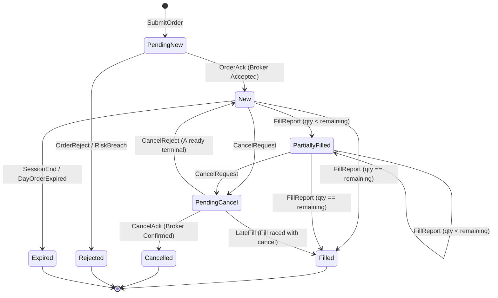

# Domain-Driven Design (DDD) in Honba

> **[STATUS: IMPLEMENTED]** — `honba-core`. See [Platform Conformance Matrix](conformance_matrix.md).

> **Architectural Paradigm**: Honba adopts a formal Domain-Driven Design (DDD) methodology inspired by institutional trading engines such as **StockSharp**, **NautilusTrader**, and LMAX Architecture. The core domain is strictly pure, zero-I/O, deterministic, and isolated from network protocols, databases, and UI frameworks.

---

## 1. Strategic Design & Bounded Contexts

In high-frequency and quantitative trading platforms, naive object models inevitably devolve into "God objects" where an `Order` contains networking sockets, broker-specific JSON strings, and database connection pools. Honba strictly enforces **Bounded Contexts** with unambiguous ubiquitous language and clean boundary mappings:

```text
 ┌────────────────────────────────────────────────────────────────────────┐
 │                      HONBA BOUNDED CONTEXTS MAP                        │
 ├────────────────────────────────────────────────────────────────────────┤
 │                                                                        │
 │   ┌───────────────────────┐              ┌─────────────────────────┐   │
 │   │ MARKET DATA CONTEXT   │              │ EXECUTION CONTEXT       │   │
 │   │ Subsystem: honba-me   │              │ Subsystem: honba-te     │   │
 │   │ (WebSockets, Feeds,   │              │ (Broker REST/FIX, SOR,  │   │
 │   │  Catalog, Lakehouse)  │              │  Rate Limits, Slicing)  │   │
 │   └──────────┬────────────┘              └────────────▲────────────┘   │
 │              │ Canonical Ticks / Bars                 │ Wire Orders    │
 │              ▼                                        │                │
 │   ┌───────────────────────────────────────────────────┴────────────┐   │
 │   │                     SHARED KERNEL: honba-core                  │   │
 │   │   - Value Objects: InstrumentId, Price, Quantity, Money, Bar   │   │
 │   │   - Wire Contracts: OrderRequest, OrderAck, FillReport         │   │
 │   │   - Decision Contract: Decision enum                           │   │
 │   └──────────────────────────┬─────────────────────────────────────┘   │
 │                              │                                         │
 │              ┌───────────────┴───────────────┐                         │
 │              ▼                               ▼                         │
 │   ┌───────────────────────┐      ┌─────────────────────────────────┐   │
 │   │ REGULATORY RISK GATE  │      │ DOMAIN HEART: honba-kokoro      │   │
 │   │ Subsystem: honba-mon  │      │ - OrderManagement Aggregate     │   │
 │   │ - SEBI Algo ID Check  │◄────►│ - Portfolio Aggregate (FIFO)    │   │
 │   │ - OTR Circuit Breaker │      │ - DoubleEntryLedger Aggregate   │   │
 │   │ - Scrip Price Bands   │      │ (Zero-I/O Deterministic Domain) │   │
 │   └───────────────────────┘      └─────────────────────────────────┘   │
 │                                                                        │
 └────────────────────────────────────────────────────────────────────────┘
```

### Context Boundary Responsibilities

| Bounded Context | Primary Crate | Ubiquitous Vocabulary | Invariants & Rules |
| :--- | :--- | :--- | :--- |
| **Shared Kernel** | `honba-core` | `InstrumentId`, `Price`, `Quantity`, `Money`, `Currency`, `Tick`, `Bar`, `Decision` | Pure types. Zero dependencies. No allocation or I/O on hot path. |
| **Domain Heart** | `honba-kokoro` | `OrderManager`, `OrderState`, `TaxLot`, `Portfolio`, `DoubleEntryLedger` | Pure business rules. Zero network/clock calls. Fully deterministic replay. |
| **Regulatory Risk** | `honba-mon` | `RiskEngine`, `RiskLimits`, `AlgoId`, `OTRTracker`, `PriceBand` | Pre-trade risk gate. Synchronous validation. Tripped breakers halt trading. |
| **Market Data** | `honba-me` | `MarketDataFeed`, `TickBuffer`, `Normalizer`, `Catalog`, `Indicator` | Ingests broker streams. Coalesces quotes. Generates canonical ticks. |
| **Execution** | `honba-te` | `BrokerExecutor`, `RateLimiter`, `OrderSlicer`, `SmartOrderRouter` | Outbound wire translation. Token-bucket rate limiting. Freeze slicing. |
| **Runtime Orchestration**| `honba-ya` | `ActorRuntime`, `BacktestEngine`, `PersistenceRepository` | Tokio actor concurrency. Supervises message pipelines and storage. |
| **AI Intelligence** | `honba-nou` | `ResearchLoop`, `PromptReplayer`, `SpecId`, `McpServer` | Closed decision parsing. Reproducible prompt & strategy replay. |

---

## 2. Shared Kernel: Canonical Value Objects (`honba-core`)

All value objects in `honba-core` are **immutable**, **self-validating**, and guarantee dimensional correctness:

### 2.1 Dimensional Types
In trading systems, treating prices, quantities, and cash as generic floats inevitably introduces rounding errors, IEEE 754 precision drifts (e.g., `0.1 + 0.2 != 0.3`), and dimensional bugs (such as accidentally adding an equity share quantity to an INR cash balance).

Honba enforces type safety through distinct value objects:

```rust
use rust_decimal::Decimal;

/// An exact execution or quote price (e.g. ₹2,450.75)
#[derive(Debug, Clone, Copy, PartialEq, Eq, PartialOrd, Ord, Hash, Serialize, Deserialize)]
pub struct Price(pub Decimal);

/// An exact share or contract count (e.g. 50 shares, 0.001 crypto)
#[derive(Debug, Clone, Copy, PartialEq, Eq, PartialOrd, Ord, Hash, Serialize, Deserialize)]
pub struct Quantity(pub Decimal);

/// An exact monetary amount in a specific currency minor-unit
#[derive(Debug, Clone, Copy, PartialEq, Eq, PartialOrd, Ord, Serialize, Deserialize)]
pub struct Money {
    pub amount: Decimal,
    pub currency: Currency,
}
```

#### Dimensional Arithmetic Guarantees:
* $\text{Price} \times \text{Quantity} = \text{Money}$ (currency derived from instrument quote asset).
* $\text{Money} + \text{Money} = \text{Money}$ (permitted only when currencies match; cross-currency addition requires an explicit exchange rate conversion).
* Construction requires non-negative quantities; prices must strictly exceed zero.

### 2.2 Canonical Identifier: `InstrumentId`
Identifies tradable assets across multiple exchanges and data vendors without ambiguous string collisions:

```rust
#[derive(Debug, Clone, PartialEq, Eq, PartialOrd, Ord, Hash, Serialize, Deserialize)]
pub struct InstrumentId {
    pub symbol: String,        // e.g. "RELIANCE", "NIFTY26OCT25000CE"
    pub exchange: Exchange,    // Exchange::NSE, Exchange::BSE, Exchange::NFO
    pub asset_class: AssetClass, // Equity, Future, Option, MutualFund
}
```

---

## 3. Domain Aggregates & Invariants (`honba-kokoro`)

Aggregates are the transactional consistency boundaries in Honba. All modifications to an aggregate root occur via explicit domain methods that enforce business invariants.

### 3.1 Order Management Aggregate: `OrderManager`

The `OrderManager` enforces a mathematically sound state machine for every order lifecycle under Indian market conditions:



#### Aggregate Invariants:
1. **Cumulative Quantity Invariant**: For any order $O$, the sum of executed fill quantities cannot exceed initial request quantity:
   $$\sum_{i=1}^n Q_{\text{fill}, i} \le Q_{\text{initial}}$$
2. **Idempotency via Client Order ID (`clOrdId`)**: Every outbound order carries a unique UUID `clOrdId`. Re-submitting an existing active `clOrdId` is rejected with `DuplicateClientOrderId`, preventing double-execution during network retries.
3. **Late-Fill Reconciliation**: When an execution fill arrives after a `PendingCancel` request has been dispatched to the exchange (a common race condition in volatile options markets):
   - If state is `PendingCancel`, the state safely updates to `Filled` (or `PartiallyFilled` with remaining marked cancelled).
   - If state is already `Cancelled`, the late fill is routed to an `UnsolicitedLateFill` reconciliation journal for human/algo audit.
4. **Bracket & OCO Coordination**:
   - In a Bracket Order (Parent Entry, Child Stop-Loss, Child Take-Profit), filling either child leg immediately triggers an automatic `CancelRequest` for the sibling child leg (One-Cancels-Other).

---

### 3.2 Portfolio & Holdings Aggregate: `Portfolio`

The `Portfolio` aggregate manages multi-account equity holdings, tax lots, and mark-to-market valuation with exact 128-bit decimal precision:

```rust
pub struct Portfolio {
    accounts: BTreeMap<AccountId, AccountState>,
}

pub struct AccountState {
    pub cash_balance: Money,
    pub positions: BTreeMap<InstrumentId, Position>,
    pub tax_lots: BTreeMap<InstrumentId, VecDeque<TaxLot>>,
}

pub struct TaxLot {
    pub lot_id: Uuid,
    pub entry_time: DateTime<Utc>,
    pub entry_price: Price,
    pub original_qty: Quantity,
    pub remaining_qty: Quantity,
    pub product: ProductType, // CNC (Delivery) vs MIS (Intraday)
}
```

#### Tax-Lot FIFO Invariant & PnL Formulation:
Under Indian tax law (Section 45, Income Tax Act), capital gains must be computed using strict **First-In, First-Out (FIFO)** lot matching:

1. **On Buy Execution**:
   A new `TaxLot` is appended to the asset's FIFO lot queue with timestamp $t$, purchase price $P_{\text{entry}}$, and quantity $Q$.
2. **On Sell Execution**:
   Lots are matched in chronological order:
   $$\text{MatchedQty} = \min(Q_{\text{fill\_remaining}}, \text{Lot.remaining\_qty})$$
   $$\text{Realized PnL} = (P_{\text{exit}} - P_{\text{entry}}) \times \text{MatchedQty} - \text{StatutoryCosts}$$
3. **Mark-to-Market (MTM) Valuation**:
   Given current tick price $P_{\text{mark}}$:
   $$\text{Unrealized PnL} = \sum_{\text{lots}} (P_{\text{mark}} - P_{\text{entry}}) \times Q_{\text{remaining}}$$
   $$\text{Net Liquidation Value} = \text{CashBalance} + \sum \text{PositionValue} - \text{AccruedLiabilities}$$
4. **Corporate Actions Adjustment**:
   - **Stock Splits (e.g. 1:10)**: Multiplies lot quantity by 10 and divides unit purchase price by 10 without affecting total cost basis.
   - **Bonus Issues**: Injects zero-cost acquisition lots tied to the original holding timestamp.

---

### 3.3 Double-Entry Financial Ledger: `DoubleEntryLedger`

To guarantee financial integrity under high-frequency trading, cash, margins, and statutory liabilities are managed through an immutable **Double-Entry General Ledger**:

$$\sum \text{Debits} = \sum \text{Credits}$$

#### Chart of Accounts:
* `Assets:Cash:ClearingAccount`
* `Assets:Holdings:DematDelivery`
* `Liabilities:Margin:SPAN`
* `Liabilities:Margin:Exposure`
* `Expenses:Taxes:STT`
* `Expenses:Taxes:StampDuty`
* `Expenses:Taxes:GST`
* `Expenses:Fees:ExchangeTurnover`
* `Expenses:Fees:SEBITurnover`
* `Equity:RealizedPnL`

#### Example Journal Entry: Buy 100 shares of INFY @ ₹1,500 (Notional: ₹1,50,000)

```text
Debit:  Assets:Holdings:DematDelivery      ₹1,50,000.00
Debit:  Expenses:Taxes:STT (0.1%)               ₹150.00
Debit:  Expenses:Taxes:StampDuty (0.015%)        ₹22.50
Debit:  Expenses:Fees:ExchangeTurnover (0.003%)   ₹4.50
Debit:  Expenses:Fees:SEBITurnover                ₹0.15
Debit:  Expenses:Taxes:GST (18% on fees)          ₹0.84
Credit: Assets:Cash:ClearingAccount        ₹1,50,177.99
```

This guarantees that unallocated cash, margin withholdings, and statutory tax liabilities reconcile down to the exact paisa at every microsecond.

---

## 4. Domain Events: The Reactive Nervous System

Domain aggregates emit immutable domain events capturing state transitions:

```rust
pub enum DomainEvent {
    OrderPlaced { order: OrderRequest, timestamp: DateTime<Utc> },
    OrderAccepted { cl_ord_id: Uuid, broker_order_id: String },
    OrderFilled { cl_ord_id: Uuid, fill: FillReport },
    OrderCancelled { cl_ord_id: Uuid, reason: String },
    OrderRejected { cl_ord_id: Uuid, reason: String },
    PositionChanged { symbol: InstrumentId, net_qty: Quantity, avg_price: Price },
    RiskBreached { algo_id: String, rule: String, details: String },
}
```

Domain events are distributed across the actor pipeline without blocking the transaction boundary, enabling downstream analytics, real-time UI streaming, and immutable audit persistence.

---

## 5. Mathematical Verifiability & Property Testing

Every aggregate in `honba-kokoro` is tested against formal invariants using the `proptest` framework:
* **Conservation of Capital**: For any random sequence of orders, fills, rejections, cancellations, and corporate actions, total equity strictly equals initial balance plus realized PnL minus transaction fees.
* **Non-Negative Demat Balance**: Delivery positions cannot drop below zero.
* **Finite State Reachability**: All order paths terminate in valid terminal states (`Filled`, `Cancelled`, `Rejected`, `Expired`) without state deadlocks.
