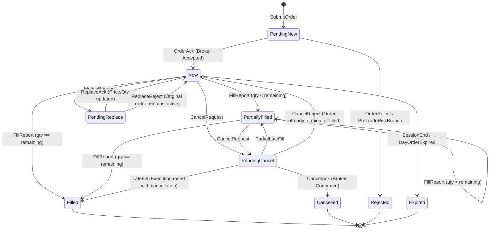

# Order Lifecycle, Rejection & Cancellation Protocol

> **[STATUS: IMPLEMENTED]** — `honba-kokoro-oms / honba-mon / honba-te`. See [Platform Conformance Matrix](conformance_matrix.md).

> **Microstructure Integrity**: How orders, cancellations, modifications, and rejections transition deterministically across the Order Management System (`honba-kokoro-oms`), pre-trade risk engine (`honba-mon`), and broker execution pipelines (`honba-te`).

---

## 1. Unified State Machine & Order Lifecycle

Every order submitted within Honba passes through a deterministic state machine strictly governed by mathematical reachability:



---

## 2. Pre-Trade Risk Rejections (`honba-mon`)

Before an order request is ever serialized or transmitted across the network, it must pass synchronous validation by the pre-trade risk gate (`honba-mon`). If a check fails, the order transitions directly:

$$\text{PendingNew} \longrightarrow \text{Rejected}$$

### 2.1 Rejection Taxonomy (`OrderRejectReason`)

```rust
#[derive(Debug, Clone, PartialEq, Eq, Serialize, Deserialize)]
pub enum OrderRejectReason {
    /// Mandatory SEBI Algo ID is missing or unregistered
    InvalidAlgoId { algo_id: String },
    /// Exchange Order-to-Trade Ratio (OTR) threshold exceeded
    OtrLimitExceeded { current_otr: u32, threshold: u32 },
    /// Order limit price breaches scrip operational circuit band
    PriceBandBreach { price: Price, lower_band: Price, upper_band: Price },
    /// Order quantity exceeds exchange single-order freeze limit
    QuantityFreezeExceeded { qty: Quantity, freeze_limit: Quantity },
    /// Insufficient ledger margin or cash balance
    InsufficientFunds { required: Money, available: Money },
    /// Maximum daily drawdown limit reached for account
    DailyLossLimitBreached { current_loss: Money, max_allowed: Money },
    /// Exchange session closed (outside 09:15–15:30 IST)
    MarketClosed { session_state: String },
    /// Duplicate client order ID detected
    DuplicateClientOrderId { cl_ord_id: Uuid },
}
```

---

## 3. Cancellation & Modification Protocol

### 3.1 Idempotency via `clOrdId`
Every outbound order carries a client-generated UUID `cl_ord_id`. When cancelling or modifying an order, strategies refer to this immutable identifier:

```rust
pub struct CancelRequest {
    pub cl_ord_id: Uuid,
    pub symbol: InstrumentId,
    pub reason: String,
    pub timestamp: DateTime<Utc>,
}
```

If a cancel request is dispatched for an already terminal order (`Filled`, `Cancelled`, `Rejected`), the OMS ignores the duplicate cancel without altering state or corrupting the ledger.

### 3.2 Cancel-Replace (Order Modification)
Modifying the price or quantity of an open limit order uses the Cancel-Replace protocol:
1. Strategy emits `ModifyOrder { cl_ord_id, new_price, new_qty }`.
2. OMS transitions state from `New` to `PendingReplace`.
3. If the broker accepts:
   - Order quantity/price updates to the new values.
   - State returns to `New`.
4. If the broker rejects the modification (e.g. order filled before modification reached exchange):
   - OMS records `ReplaceReject`.
   - The original order parameters remain active in state `New`.

---

## 4. Race Conditions & Late-Fill Reconciliation

In volatile options markets (such as NIFTY zero-day-to-expiry options), an execution fill and a cancellation acknowledgment frequently cross on the wire:

```text
 STRATEGY                   OMS ACTOR                  EXCHANGE / BROKER
    │                           │                              │
    │── CancelRequest ─────────▶│                              │
    │                           │── Wire Cancel ──────────────▶│ (Races on wire)
    │                           │                              │
    │                           │◀── FillReport (Executed) ────│ (Matched before cancel)
    │                           │    [LATE FILL ARRIVES]       │
    │                           │                              │
    │                           │◀── CancelReject (Too late) ──│
    │                           │                              │
```

### Protocol Handling Rules:
* **Case 1: Fill arrives while `PendingCancel`**:
  The OMS accepts the fill. The state transitions to `Filled` (or `PartiallyFilled` with the remainder marked cancelled). The portfolio and double-entry ledger process the fill immediately.
* **Case 2: Fill arrives after `Cancelled` (Unsolicited Late Fill)**:
  If a broker reports an execution after an order was already marked `Cancelled`:
  1. The OMS logs the fill to an immutable `UnsolicitedLateFill` audit journal.
  2. The portfolio updates position quantities to reflect real Demat holdings.
  3. A high-priority operational alert is triggered for risk reconciliation.
* **Guaranteed Cumulative Fill Invariant**:
  $$\sum Q_{\text{fill}} \le Q_{\text{initial}}$$
  Under no circumstances can the OMS accept fills whose cumulative quantity exceeds the original order request.
