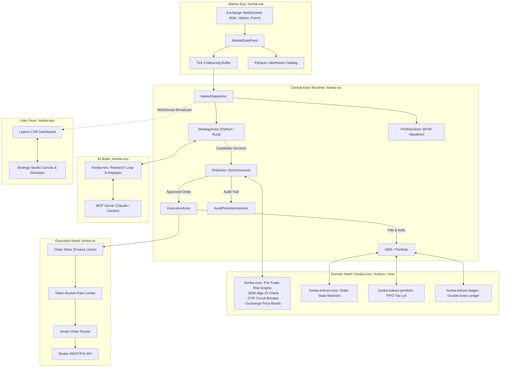

# Honba System Architecture Overview

> **[STATUS: IMPLEMENTED]** — `all crates`. See [Platform Conformance Matrix](conformance_matrix.md).

> **本場 (Honba)**: An institutional-grade, AI-native algorithmic trading operating system and quantitative research platform designed for high-frequency responsiveness, temporal determinism, and full regulatory compliance across Indian (NSE, BSE, NFO, MCX) and international capital markets.

---

## 1. Executive Summary & Design Vision

Modern quantitative trading platforms typically suffer from a painful architectural compromise:
1. **Python-only platforms (e.g. Backtrader, early Zipline)** offer high developer productivity but suffer from severe GIL bottlenecks, slow tick execution loops, and poor concurrency.
2. **C++/C# institutional engines (e.g. legacy FIX engines, early StockSharp)** offer sub-microsecond execution speed and strict domain models but provide poor developer ergonomics for rapid quantitative research and machine learning integration.
3. **AI wrappers** tack LLM prompts onto loose Python scripts with dynamic string execution (`eval`), hallucinating fake trades and failing exchange pre-trade risk controls.

**Honba eliminates this compromise.** It bridges high-level Python ergonomics with a bare-metal, multi-threaded Rust actor engine, formal Domain-Driven Design (DDD), and an AI-native research operating system:

```text
 ┌────────────────────────────────────────────────────────────────────────┐
 │                      HONBA UNIFIED ARCHITECTURE                        │
 ├────────────────────────────────────────────────────────────────────────┤
 │  USER & RESEARCH APIS                                                  │
 │  - Python-First Strategy SDK (like NautilusTrader & Jesse)             │
 │  - Interactive Leptos CSR Web Studio & Simulator (`honba-kao`)         │
 │  - Native Model Context Protocol (MCP) Server for Frontier AI Agents   │
 ├────────────────────────────────────────────────────────────────────────┤
 │  CENTRAL MULTI-THREADED ACTOR RUNTIME (`honba-ya`)                     │
 │  - Pinned worker threads, lock-free MPSC channels (like NautilusTrader)│
 │  - Supervised actor pipeline: MarketData, Strategy, Risk, Exec, MTM    │
 │  - GIL-released execution: Rust handles high-rate ticks without Python │
 ├────────────────────────────────────────────────────────────────────────┤
 │  AI-NATIVE ENGINE (`honba-nou`)                                        │
 │  - Autonomous Hypothesis-to-Live Research Loop                         │
 │  - Closed Decision Grammar (`honba_core::Decision`)                    │
 │  - Cryptographic Prompt & Decision Replayer (SHA-256 deterministic)    │
 ├────────────────────────────────────────────────────────────────────────┤
 │  STRATEGY TESTER & AUTOMATIC ENHANCER (like Jesse)                     │
 │  - Event-driven backtester with microsecond Indian market simulation   │
 │  - Genetic Algorithm (GA) & Bayesian Hyperparameter Optimization      │
 │  - Walk-Forward Analysis (WFO), Monte Carlo Stressing, DSR & PBO       │
 ├────────────────────────────────────────────────────────────────────────┤
 │  DOMAIN-DRIVEN DESIGN & ZERO-I/O CORE (like StockSharp)                │
 │  - Shared Kernel (`honba-core`): canonical Value Objects & Contracts   │
 │  - Aggregates (`honba-kokoro`): Formal OMS State Machine, FIFO Tax-Lots│
 │  - Immutable Double-Entry Ledger: exact paisa / cash / STT tracking    │
 │  - Pre-Trade Regulatory Gate (`honba-mon`): SEBI Algo ID, OTR breaker  │
 ├────────────────────────────────────────────────────────────────────────┤
 │  MICROSTRUCTURE ADAPTERS                                               │
 │  - Inbound WebSocket Eye (`honba-me`): Kite, Upstox, Fyers, Angel One  │
 │  - Outbound Execution Hand (`honba-te`): Token bucket, Slicing, SOR    │
 └────────────────────────────────────────────────────────────────────────┘
```

---

## 2. Core Architectural Pillars

### 2.1 Python First (like NautilusTrader, StockSharp, and Jesse)
Quantitative researchers live in Python. Honba provides an ergonomic, object-oriented Strategy API that feels as natural and pythonic as Jesse or NautilusTrader:
* **Ergonomic Strategy API**: Users subclass `Strategy` and implement lifecycle hooks (`on_start`, `on_bar`, `on_tick`, `on_order_event`).
* **Zero-Copy PyO3 Bridge (`honba-tamashii`)**: The platform compiles as a native C-extension (`honba`). High-frequency tick normalization, order book maintenance, risk checks, and accounting happen in compiled Rust.
* **Non-Blocking GIL Lifecycle**: Rust worker threads operate completely detached from Python's Global Interpreter Lock (GIL). The GIL is acquired only when dispatching events into user-defined Python callbacks.
* **Vectorized Data Integration**: Native integration with PyArrow and Polars for zero-copy feature extraction, historical data loading, and indicator computation.

### 2.2 Domain-Driven Design (DDD) & Zero-I/O Purity (like StockSharp)
Inspired by the clean architectural boundaries of StockSharp and standard enterprise DDD:
* **Shared Kernel (`honba-core`)**: Houses primitive Value Objects (`Price`, `Quantity`, `Money`, `Currency`, `InstrumentId`), domain contracts, and wire payloads. Pure zero-I/O, zero external dependencies.
* **Rich Domain Aggregates (`honba-kokoro`)**:
  - `OrderManager`: Deterministic state machine governing order transitions (`PendingNew`, `New`, `PartiallyFilled`, `Filled`, `PendingCancel`, `Cancelled`, `Rejected`).
  - `Portfolio`: Tax-lot FIFO matching engine for delivery (`CNC`) vs intraday (`MIS`) products, tracking real-time Mark-to-Market (MTM) and corporate actions.
  - `DoubleEntryLedger`: Complete financial integrity enforcing $\sum \text{Debits} = \sum \text{Credits}$ across cash, margin, statutory taxes, and fees.
* **Authoritative Risk Gate (`honba-mon`)**: Pure synchronous domain service enforcing SEBI Algo ID verification, Order-to-Trade Ratio (OTR) sliding-window circuit breakers, and scrip price bands before orders can leave the engine.
* **Exact 128-bit Decimal Arithmetic**: Floating-point numbers are strictly forbidden for prices, quantities, cash, and taxes (`rust_decimal::Decimal`).

### 2.3 Responsive, Multithreaded Actor Concurrency (like NautilusTrader)
To maintain sub-microsecond reactivity under extreme market volatility without deadlocks:
* **Actor-Oriented Architecture**: Subsystems communicate exclusively via asynchronous, typed message-passing over bounded `tokio::sync::mpsc` channels.
* **Dedicated Actor Pipeline**:
  - `MarketDataActor`: Ingests raw exchange streams, normalizes binary protocols, coalesces quotes during backpressure bursts, and broadcasts canonical ticks.
  - `StrategyActor`: Runs strategy decision logic (Python or Rust) in isolated worker threads.
  - `RiskActor`: Executes synchronous pre-trade validation against `honba-mon`.
  - `ExecutionActor`: Manages broker rate limits, order slicing, and network dispatch via `honba-te`.
  - `PortfolioActor`: Updates MTM marks, margin utilization, and FIFO tax lots.
  - `AuditPersistenceActor`: Asynchronously streams immutable event logs to SQLite WAL / PostgreSQL / Parquet.
* **Zero Allocation on Hot Paths**: Reusable event buffers and lock-free ring-buffers ensure predictable low-latency execution.

### 2.4 AI-Native Research & Decision Architecture (`honba-nou`)
Honba does not treat AI as a toy chat interface; it is an integrated quantitative research operating system:
* **Closed Decision Grammar (`honba_core::Decision`)**: LLM agents cannot emit arbitrary commands. They must emit strictly typed JSON conforming to `honba_core::Decision` (`PlaceOrder`, `ModifyOrder`, `CancelOrder`, `CancelAll`, `Hold`), parsed with `serde(deny_unknown_fields)`.
* **Mathematical Indicator Catalog**: Frontier models are bounded by a verified catalog of mathematically sound indicators with strict parameter bounds, preventing formula hallucinations.
* **Deterministic Prompt & Decision Replay**: Inbound prompts, market features, model temperatures, seeds, and raw completions are hashed (SHA-256) and archived. AI strategies can be backtested deterministically over years of historical data.
* **Model Context Protocol (MCP)**: Native MCP server exposing tools (`get_indicator_catalog`, `run_backtest`, `evaluate_metrics`, `explain_decision`) directly to autonomous LLM quant agents (Claude, Gemini).

### 2.5 Strategy Tester & Automatic Strategy Enhancer (like Jesse)
A world-class strategy validation and automated optimization suite:
* **Research-Live Parity**: The exact same strategy code executes in backtesting, paper trading, and multi-broker live execution without modification.
* **Microstructure Simulator (`honba-ya-backtest`)**: Replays historical ticks/bars with L2 order book walking, fill slippage, queue position modeling, Indian market hours (09:15–15:30 IST), and exchange holidays.
* **Automatic Strategy Enhancer**:
  - **Multi-Objective Genetic Algorithm (GA)**: Evolves strategy parameters using tournament selection, crossover, and mutation to discover Pareto-optimal parameter sets.
  - **Bayesian Optimization (TPE)**: Intelligent exploration of complex parameter spaces.
  - **Walk-Forward Analysis (WFO)**: Anchored and rolling out-of-sample testing to detect curve-fitting.
  - **Overfitting Diagnostics**: Computes Deflated Sharpe Ratio (DSR) and Probability of Backtest Overfitting (PBO).
  - **Monte Carlo Stress Testing**: Permutes trade execution sequences and injects synthetic spread/slippage shocks.
  - **AI Refinement Loop**: Closed-loop agent analyzes drawdowns and trade journals, automatically suggesting parameter refinements and hedging rules.

---

## 3. Subsystem Interaction Matrix



---

## 4. End-to-End Event Lifecycle

The lifecycle of an order from market event to demat settlement:

```text
1. [TICK INGESTION]
   Exchange sends binary tick via WebSocket -> honba-me decodes binary frame
   -> Normalizes to canonical honba_core::Tick -> Enriches with scrip circuit band.

2. [ACTOR DISPATCH]
   Tick is queued into bounded mpsc channel -> MarketDataActor processes tick
   -> Broadcasts to StrategyActor and PortfolioActor.

3. [SIGNAL GENERATION (Python / Rust)]
   Strategy processes tick/bar -> Evaluates indicators / ML models
   -> Emits candidate Decision (e.g., Decision::PlaceOrder).

4. [PRE-TRADE RISK VALIDATION (honba-mon)]
   RiskActor synchronously evaluates candidate Decision:
   * Is SEBI Algo ID registered and valid?
   * Does current Order-to-Trade Ratio (OTR) sit within exchange safety limits?
   * Is limit price within exchange operational circuit band?
   * Does order quantity comply with exchange freeze limits?
   -> If violated: Decision is immediately rejected and logged.
   -> If passed: OrderRequest is forwarded to ExecutionActor.

5. [OMS STATE TRANSITION]
   honba-kokoro-oms assigns unique client order ID (clOrdId)
   -> Transitions order state to PendingNew.

6. [EXECUTION DISPATCH (honba-te)]
   ExecutionActor checks broker token bucket rate limiter
   -> Slices order if quantity exceeds freeze threshold
   -> Routes via SOR to broker REST/FIX gateway with headless TOTP authentication.

7. [EXECUTION CONFIRMATION & FILL]
   Broker returns execution acknowledgment / postback fill report
   -> honba-kokoro-oms transitions: PendingNew -> New -> Filled.

8. [PORTFOLIO & DOUBLE-ENTRY LEDGER RECONCILIATION]
   Fill event triggers honba-kokoro-portfolio:
   * Tax-lot FIFO matching records realized PnL.
   * Mark-to-Market (MTM) equity updates.
   * honba-kokoro-ledger writes balanced debits/credits:
     Debit Assets:Holdings, Debit Expenses:STT/GST/StampDuty, Credit Assets:Cash.

9. [AUDIT TRAIL PERSISTENCE]
   All events, raw wire payloads, and timestamps are persisted to SQLite WAL
   with SHA-256 tamper-evident hash chaining for SEBI compliance.
```

---

## 5. Architectural Guide Directory

Detailed design specifications are organized by domain:

* **[Domain-Driven Design (DDD)](domain_driven_design.md)**: StockSharp-inspired bounded contexts, domain aggregates, and formal OMS state invariants.
* **[Python-First Architecture](python_first.md)**: Python strategy ergonomics, PyO3 zero-copy FFI bridge, and GIL-free async runtime.
* **[Strategy Tester & Automatic Enhancer](strategy_tester_and_enhancer.md)**: Microstructure backtesting, genetic/Bayesian optimization, Monte Carlo simulation, and AI auto-tuning.
* **[AI Engine & Quant Researcher](ai_engine.md)**: Closed decision grammar, deterministic prompt replay, and autonomous research loops.
* **[Actor Runtime & Event Loop](event_loop.md)**: Multi-threaded Tokio concurrency, actor topology, and lock-free channel architecture.
* **[Adapter Interface & Market Feeds](adapter_interface.md)**: Multi-broker WebSocket feeds, rate limiters, freeze slicing, and smart routing.
* **[Money, Currency & Indian Costs](money.md)**: 128-bit decimal arithmetic and statutory Indian cost formulas (STT, Stamp Duty, GST, ICCL T+1).
* **[Order Management & Rejections](order_reject_cancel.md)**: State machine transitions, idempotency, late fills, and cancel-replace logic.
* **[Strategy Studio & Simulator](strategy_studio.md)**: Leptos CSR visual node canvas, WASM indicators, and interactive workbench.
