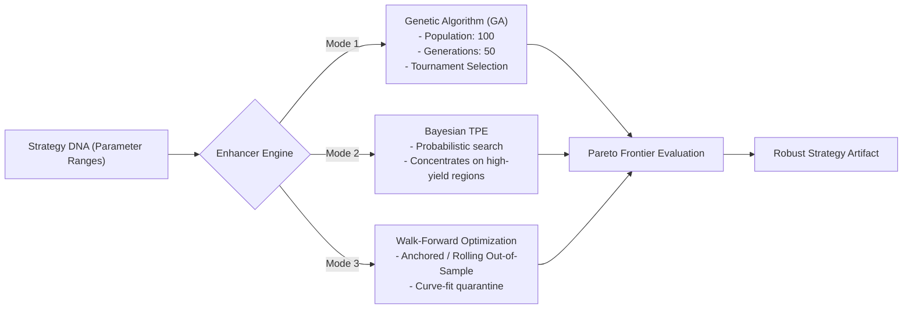
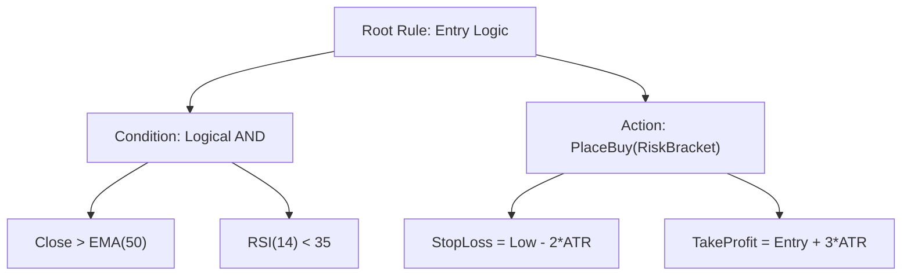

# Strategy Tester & Automatic Strategy Enhancer

> **[STATUS: IMPLEMENTED]** — `honba-ya-backtest / honba-ya-enhancer`. See [Platform Conformance Matrix](conformance_matrix.md).

> **Research-to-Production Parity**: Inspired by **Jesse's** elegant declarative optimization engine and institutional quant testing methodologies (Marcos López de Prado), Honba combines a high-throughput, microsecond-fidelity event-driven strategy backtester with an automated strategy enhancer powered by Genetic Algorithms, Bayesian Optimization, Walk-Forward Analysis, and AI-native prompt mutation.

---

## 1. Architectural Philosophy: The Anti-Overfitting Doctrine

Quantitative trading history is littered with strategies that produced spectacular backtests but collapsed immediately in live trading. This failure stems from two universal pitfalls:
1. **Unrealistic Market Microstructure**: Ignoring order book depth, exchange freeze limits, spread crossing, statutory Indian taxes (STT, GST, Stamp Duty), and T+1 Demat settlement.
2. **Backtest Overfitting (Data Dredging)**: Running brute-force parameter sweeps until a curve-fitted parameter set happens to exploit random historical noise.

Honba's **Strategy Tester & Automatic Enhancer** enforces an unbending anti-overfitting doctrine:

```text
 ┌────────────────────────────────────────────────────────────────────────┐
 │            HONBA STRATEGY TESTER & AUTOMATIC ENHANCER                  │
 ├────────────────────────────────────────────────────────────────────────┤
 │  TIER 1: HIGH-THROUGHPUT EVENT-DRIVEN SIMULATOR (`honba-ya-backtest`) │
 │  - Microsecond event loop with research-live parity                    │
 │  - Exact statutory Indian cost model (STT, Stamp Duty, GST, Turnover)  │
 │  - NSE trading calendar, 15:20 MIS square-off, T+1 settlement          │
 ├────────────────────────────────────────────────────────────────────────┤
 │  TIER 2: AUTOMATIC STRATEGY ENHANCER                                   │
 │  - Multi-Objective Genetic Algorithm (GA) with tournament selection   │
 │  - Bayesian Optimization (Tree-structured Parzen Estimator / TPE)      │
 │  - Walk-Forward Analysis (WFO): Anchored & Rolling Out-of-Sample tests  │
 ├────────────────────────────────────────────────────────────────────────┤
 │  TIER 3: STATISTICAL ROBUSTNESS & OVERFITTING GUARDRAILS               │
 │  - Deflated Sharpe Ratio (DSR) & Probability of Backtest Overfitting   │
 │  - Monte Carlo Simulation: Trade sequence permutation & slippage shock │
 ├────────────────────────────────────────────────────────────────────────┤
 │  TIER 4: AI-NATIVE CLOSED-LOOP STRATEGY REFLECTION (`honba-nou`)       │
 │  - AI Agent diagnoses drawdown clusters & regime failure modes         │
 │  - Autonomous rule mutation & parameter boundary expansion             │
 └────────────────────────────────────────────────────────────────────────┘
```

---

## 2. Institutional Strategy Tester (`honba-ya-backtest`)

The backtesting engine executes against pure `honba-core` types, guaranteeing **100% byte-for-byte behavioral parity with live execution**:

### 2.1 Microstructure Simulation Features
* **Zero Lookahead Bias**: Point-in-time tick/bar replay. Future prices are strictly inaccessible to the strategy.
* **L2 Order Book Walking & Fill Slippage**: Large orders walk the simulated order book, suffering realistic market impact and partial fills.
* **SEBI Freeze Limit Auto-Slicing**: Quantities exceeding exchange freeze limits (e.g. Nifty 1,800, BankNifty 900) are automatically sliced into parent-child legs with execution jitter.
* **Exchange Hours & Intraday Square-off**:
  - Regular trading: 09:15 to 15:30 IST.
  - Automated intraday square-off at 15:20 IST for all leveraged positions (`ProductType::MisIntraday`), identical to retail broker risk desks.
* **Exact Indian Statutory Cost Accounting**:
  - Securities Transaction Tax (STT): 0.1% for Delivery, 0.025% sell-side for MIS equity, 0.0625% for Option premium.
  - State Stamp Duty, NSE turnover charges, SEBI turnover fees, and 18% GST.
  - All debited instantaneously via the `honba-kokoro-ledger` double-entry accounting engine.

```rust
// Invoking a backtest run via honba-ya-backtest
let config = BacktestConfig {
    symbol: InstrumentId::nse_equity("RELIANCE"),
    start_date: NaiveDate::from_ymd_opt(2025, 1, 1).unwrap(),
    end_date: NaiveDate::from_ymd_opt(2025, 12, 31).unwrap(),
    initial_cash: Money::inr(1_000_000), // ₹10,00,000 initial capital
    slippage_model: SlippageModel::OrderBookImpact { bps: 5 },
    cost_model: CostModel::IndianStatutoryTax,
};

let engine = BacktestEngine::new(config);
let report = engine.run(&mut my_strategy).await?;
```

---

## 3. Automatic Strategy Enhancer (like Jesse)

Inspired by Jesse's optimization engine, Honba allows strategies to define their genetic parameter space declaratively. The enhancer then discovers resilient parameter regions rather than brittle, overfit points.

### 3.1 Declarative Strategy DNA
Strategy parameters expose their search ranges directly in Python:

```python
from honba import Parameter

class TrendBreakout(Strategy):
    # Declarative search space
    donchian_period = Parameter(default=20, min=10, max=60, step=2)
    atr_filter = Parameter(default=14, min=7, max=28, step=1)
    risk_reward = Parameter(default=2.0, min=1.5, max=4.0, step=0.25)
    stop_atr_mult = Parameter(default=1.5, min=1.0, max=3.0, step=0.25)
```

### 3.2 Optimization Modes



#### 1. Genetic Algorithm (GA) Optimization
* **Chromosome Representation**: An encoded vector of discrete parameter choices.
* **Fitness Function**: Multi-objective fitness scoring balancing Sharpe Ratio, Sortino Ratio, Maximum Drawdown, and Profit Factor:
  $$\text{Fitness} = \text{Sharpe} \times \log(1 + \text{ProfitFactor}) \times (1 - \text{MaxDrawdown})$$
* **Tournament Selection & Elitism**: Preserves the top 5% of candidate performers while mutating child chromosomes with Gaussian jitter.

#### 2. Bayesian Optimization (TPE)
Utilizes Tree-structured Parzen Estimators to construct a probabilistic model of parameter performance, prioritizing search regions with highest expected improvement.

#### 3. Walk-Forward Analysis (WFO)
The ultimate defense against overfitting. The historical dataset is divided into alternating **In-Sample (Train)** and **Out-of-Sample (Test)** windows:
* Parameters optimized on Year 1 are evaluated out-of-sample on Year 2.
* A strategy is certified only if its **Walk-Forward Efficiency (WFE)** exceeds 60%:
  $$\text{WFE} = \frac{\text{Sharpe}_{\text{out-of-sample}}}{\text{Sharpe}_{\text{in-sample}}} \ge 0.60$$

---

## 4. Rigorous Overfitting Guardrails: DSR, PBO & Monte Carlo

### 4.1 Deflated Sharpe Ratio (DSR)
Following Marcos López de Prado's seminal research, running $N$ backtest trials will eventually produce a high Sharpe ratio purely by chance. Honba automatically computes the **Deflated Sharpe Ratio (DSR)**:

$$\text{DSR} = P\left( \widehat{\text{SR}} > \text{SR}_0 \mid N, \gamma_3, \gamma_4, V \right)$$

* Adjusts for the number of trials ($N$), return skewness ($\gamma_3$), kurtosis ($\gamma_4$), and variance of trial Sharpe ratios ($V$).
* Any strategy with $\text{DSR} < 0.95$ is flagged as likely overfit and denied live deployment.

### 4.2 Probability of Backtest Overfitting (PBO)
Using Combinatorially Symmetric Cross-Validation (CSCV), Honba slices historical sub-periods, constructs thousands of out-of-sample combinations, and measures the probability that the in-sample optimal strategy underperforms the median out-of-sample. A strategy is accepted only when $\text{PBO} < 0.10$.

### 4.3 Monte Carlo Permutation & Stress Testing
Once candidate parameters are selected, Honba's Monte Carlo engine simulates 10,000 alternative market histories:
1. **Trade Sequence Permutation**: Shuffles the chronological order of executed trades without replacement to evaluate worst-case drawdown duration and risk of ruin.
2. **Slippage & Spread Shock Injection**: Multiplies execution costs by $1.5\times$, $2.0\times$, and $3.0\times$ to determine strategy break-even fragility.
3. **Synthetic Gap Testing**: Simulates opening gap-down events of 2% to 5% to verify stop-loss robustness.

---

## 5. StockSharp Odysseus & Genetic Strategy Synthesis

Inspired by **StockSharp Odysseus (`StockSharp.Algo.Analytics / Odysseus`)**, Honba incorporates automated genetic strategy synthesis and market regime analytics:

### 5.1 AST-Based Rule Tree Synthesis (Odysseus Port)
Rather than tuning a fixed set of scalar numbers, Odysseus generates and evolves an **Abstract Syntax Tree (AST)** of trading logic:
* **Condition Nodes**: Relational comparisons between indicators (from the 100+ StockSharp catalog), threshold crossings (e.g. `RSI < 30`), and boolean gates (`AND`, `OR`, `NOT`).
* **Action Nodes**: Order placements (`PlaceBuyLimit`, `PlaceSellMarket`, `ClosePosition`, `TrailingStop`).
* **Sizing Nodes**: Fixed notional, Kelly fraction, or ATR-volatility normalized lot sizing.



### 5.2 Genetic Programming Operators
* **Subtree Crossover**: Swaps logical branches between successful strategies.
* **Point Mutation**: Mutates thresholds, comparison operators, or swaps indicators with equivalent types from the catalog.
* **Multi-Objective Pareto Selection**: Selects candidates that dominate the multi-dimensional frontier across Sharpe, Sortino, Profit Factor, and Max Drawdown.

### 5.3 Market Regime Clustering (StockSharp Analytics)
* Integrates Hidden Markov Models (HMM) and KMeans clustering to classify market states into `TrendingBull`, `TrendingBear`, `HighVolatilityChop`, and `LowVolatilityMeanReverting`.
* Dynamically activates regime-appropriate strategy subtrees.

---

## 6. AI-Native Automatic Strategy Enhancer Loop

Beyond numerical hyperparameter tuning, Honba's AI Engine (`honba-nou`) provides an **autonomous qualitative strategy refinement loop**:

```text
 ┌──────────────────────────────────────────────────────────────┐
 │ 1. EXECUTE BACKTEST & GENERATE TEAR-SHEET                    │
 │    - Identify drawdown clusters (e.g., choppy sideways days) │
 │    - Identify loss distribution & average time in trade      │
 └──────────────────────────────┬───────────────────────────────┘
                                │ Backtest Diagnostics
                                ▼
 ┌──────────────────────────────────────────────────────────────┐
 │ 2. AI DIAGNOSTIC REFLECTION (Claude / Gemini via MCP)        │
 │    - Prompt: "Strategy loses 12% during rangebound sessions.  │
 │      Diagnose momentum decay and formulate hedging filter."   │
 └──────────────────────────────┬───────────────────────────────┘
                                │ Hypothesis Formulation
                                ▼
 ┌──────────────────────────────────────────────────────────────┐
 │ 3. CLOSED-GRAMMAR SPECIFICATION MUTATION                     │
 │    - AI selects approved indicator filter from Catalog       │
 │      (e.g., adding ADX > 25 trend strength gate)             │
 │    - Expands parameter search space in strategy spec         │
 └──────────────────────────────┬───────────────────────────────┘
                                │ Mutated Strategy Spec
                                ▼
 ┌──────────────────────────────────────────────────────────────┐
 │ 4. RE-EVALUATE OUT-OF-SAMPLE IN HONBA-YA-BACKTEST            │
 │    - Must improve Out-of-Sample Sharpe without reducing WFE  │
 │    - Log iteration to immutable Hypothesis Journal           │
 └──────────────────────────────────────────────────────────────┘
```

This delivers a true automated quant assistant that does not merely fiddle with knobs, but logically refines trading hypotheses within strict mathematical guardrails.
